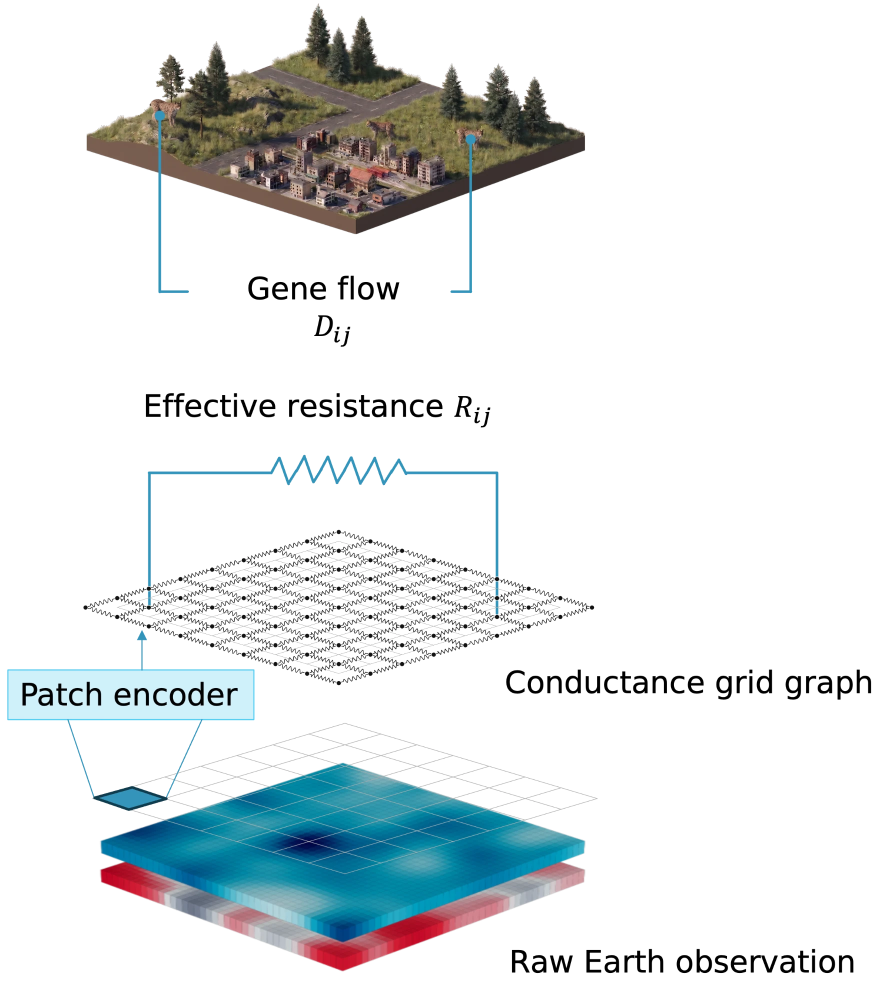

# ILG Toolkit

**Inverse landscape genetics in JAX.**

[](https://github.com/vboussange/ilg-toolkit/actions/workflows/checks.yml)

ILG Toolkit learns how landscape features relate to pairwise genetic observations
among populations or individuals. Start with one species: supply a raster, located
sampling units, and genetic observations to `fit`, then request genetic predictions
with `predict`. Multispecies support is experimental.

<p align="center">
  
</p>

**Conductance model illustration.** A patch encoder maps landscape features to a
conductance surface. Effective resistance through its grid graph is the ecological
distance between sampling units. Genetic calibration relates that distance to the
observed genetic dissimilarity.

## Concepts

Landscape genetics studies how landscapes shape gene flow through dispersal and
mating. Inverse landscape genetics learns these relationships from genetic
observations and landscape features. Different conductance surfaces can produce
similar ecological distances between sampled locations, so a fitted surface
requires ecological interpretation alongside predictive evaluation.

- **Region batch:** a raster and sampling-unit identifiers with integer
  `(row, column)` locations. Features use a [Coordax](https://coordax.readthedocs.io/)
  field with `row`, `column`, and `feature` dimensions; named features retain their
  meanings and order across regions. Prepare aligned, normalized rasters before
  constructing a batch.
- **Pairwise genetic observations:** measurements between sampling units, supplied
  as labeled pairs or a matrix with missing measurements represented by `NaN`.
  `TargetSpec` defines their meaning, units, kind, and transform.
- **Distance model:** derives ecological distances from the landscape.
  `distance_model.predict(region)` returns a `Prediction` aligned with query pairs.
- **Landscape genetics model:** combines a distance model and genetic calibration.
  `model.predict(region)` returns genetic predictions on the target's original scale.
  `prediction.as_matrix()` arranges values symmetrically, with `NaN` for the
  diagonal and unrequested pairs.

The distance-model hierarchy has three abstract classes and three concrete models:

```text
AbstractDistanceModel — ecological distances from landscape features
├── ConductanceModel — effective resistance through a conductance surface
│   ├── LogLinearConductance — log-linear conductance from patch-averaged covariates
│   └── ResNet9Conductance — a residual network producing patch conductances
└── EmbeddingModel — squared embedding distance
    └── UNet — a U-Net producing landscape embeddings
```

## Install

```bash
uv add "ilg-toolkit @ git+https://github.com/vboussange/ilg-toolkit@v0.0.3"
```

Python 3.12 or newer is required. `pip install` accepts the same requirement string.
Optional extras use `ilg-toolkit[amg] @ git+...`:

- `geo`: GeoPandas and Rasterio for preparing geospatial inputs;
- `amg`: algebraic multigrid preconditioning for resistance calculations;
- `gpu`: CUDA-enabled JAX on Linux x86-64.

The quickstart uses the base install and runs on a central processing unit (CPU).

## Quickstart

Fit a conductance model to three synthetic populations, inspect its predictions,
and save and reload it. This is [examples/quickstart.py](examples/quickstart.py).

```python
"""Fit a conductance model to synthetic genetic dissimilarities, then save and reload it."""

from typing import cast

import coordax as cx
import jax
import jax.numpy as jnp

from ilg_toolkit import (
    PairwiseObservations,
    RegionBatch,
    TargetSpec,
    TrainingConfig,
    fit,
    load_model,
    save_model,
)
from ilg_toolkit.models import ConductanceModel, ResNet9Conductance

# Effective resistance needs float64: enable x64 before creating any inputs.
jax.config.update("jax_enable_x64", True)

# An 8x8 raster with two covariates, and three sampling units at (row, column) cells.
region = RegionBatch(
    name="synthetic-valley",
    features=cx.field(
        jax.random.normal(jax.random.key(4), (8, 8, 2), dtype=jnp.float32),
        "row",
        "column",
        cx.LabeledAxis("feature", ["elevation", "habitat"]),
    ),
    sampling_unit_ids=("south", "north", "east"),
    grid_positions=[[0, 0], [0, 7], [7, 7]],
)
# Pairwise genetic observations with their meaning, units, and transform.
observations = PairwiseObservations.from_matrix(
    region.sampling_unit_ids,
    [[0, 0.375, 0.5], [0.375, 0, 0.375], [0.5, 0.375, 0]],
    target=TargetSpec("synthetic genetic dissimilarity", units="index", transform="identity"),
)
# patch_size=4 coarsens the 8x8 raster into a 2x2 conductance grid graph.
distance_model = ResNet9Conductance(
    in_channels=2, patch_size=4, min_conductance=1e-6, key=jax.random.key(6)
)
result = fit(
    region,
    observations,
    distance_model=distance_model,
    config=TrainingConfig(objective="direct_log1p", steps=4, learning_rate=0.001),
)
model = result.model  # The selected landscape genetics model.

print(
    "Conductance surface:\n",
    cast(ConductanceModel, model.distance_model).conductance_surface(region),
)
print(
    "Ecological distances (effective resistance):\n",
    model.distance_model.predict(region).as_matrix(),
)
# predict returns one genetic prediction per distinct pair, in the target's units;
# as_matrix lays them out symmetrically in sampling-unit order.
prediction = model.predict(region)
print("Genetic predictions:", prediction.pairs, prediction.values)
print("Genetic prediction matrix:\n", prediction.as_matrix())

# Loading needs a template distance model with the same configuration.
save_model("model.eqx", model)
template = ResNet9Conductance(
    in_channels=2, patch_size=4, min_conductance=1e-6, key=jax.random.key(0)
)
restored = load_model("model.eqx", distance_model=template)
print("Restored predictions:\n", restored.predict(region).as_matrix())
```

## Training

`fit` returns a training state whose `.model` is the selected landscape genetics
model. Validation selects the evaluated step with the lowest loss; without
validation, the final evaluated model is retained.

| `TrainingConfig` field | Meaning | Default |
| --- | --- | --- |
| `objective` | `"direct_log1p"` regression or maximum-likelihood population effects (`"mlpe"`) | Required |
| `steps` | Total optimizer updates; zero fits calibration with a frozen distance model | `100` |
| `eval_every` | Full evaluation interval; step zero and the final step are also evaluated | `1` |
| `learning_rate` | Adam learning rate | `0.001` |
| `region_batch_size` | Regions sampled per update | `None` (all) |
| `seed` | Training random seed | `0` |
| `jit` | Enable just-in-time compilation | `True` |
| `mlpe` | `MLPEConfig` variance, jitter, and numerical settings | `MLPEConfig()` |

Experimental multispecies training also accepts `species_batch_size` (species
sampled per selected region) and `species_microbatch_size` (species processed
together). Both default to `None`. The [performance guide](docs/performance.md)
explains sampling and memory controls, and the [statistics guide](docs/statistics.md)
defines the objectives and prediction modes.

## Examples

All examples use one species except `multispecies.py`.

- [quickstart.py](examples/quickstart.py): fit, predict, save, and load.
- [resnet9conductance.py](examples/resnet9conductance.py): a ResNet9 conductance
  model with configured resistance-solver tolerance.
- [shared_regions.py](examples/shared_regions.py): a U-Net distance model fitted
  to regions of different extents.
- [mlpe_calibration.py](examples/mlpe_calibration.py): maximum-likelihood population
  effects (MLPE) calibration for a frozen distance model.
- [region_transfer.py](examples/region_transfer.py): fit genetic calibration in a
  new region with zero optimizer steps.
- [ensemble.py](examples/ensemble.py): fold ensembles, out-of-fold evaluation,
  support conditioning, and checkpoint continuation.
- [ibd.py](examples/ibd.py): an isolation-by-distance (IBD) reference from geographic
  separation.
- [multispecies.py](examples/multispecies.py): experimental multispecies inputs,
  fitting, predictions, and conductance surfaces.

From a clone, run an example with
`JAX_PLATFORMS=cpu JAX_ENABLE_X64=true uv run python examples/<name>.py`.

## Documentation

- [README](README.md): overview, installation, quickstart, and training controls.
- [Glossary](GLOSSARY.md): domain vocabulary.
- [Models](docs/models.md): model settings, custom distance models, and experimental
  multispecies queries.
- [Statistics](docs/statistics.md): objectives, genetic calibration, and MLPE conditioning.
- [Evaluation](docs/evaluation.md): fold ensembles, holdouts, coverage, and scoring.
- [Persistence](docs/persistence.md): model templates, precision, and continuation.
- [Performance](docs/performance.md): requested pairs, memory controls, resistance,
  and MLPE calculations.
- [Wishart reference](docs/statistics/wishart.md): experimental fixed-parameter
  likelihood scoring.
- [Agent instructions](AGENTS.md): repository and authoring conventions.
- [Domain documentation guidance](docs/agents/domain.md): glossary and architectural decisions.
- [Issue tracker guidance](docs/agents/issue-tracker.md): specs, tickets, and dependencies.
- [Triage labels](docs/agents/triage-labels.md): issue readiness roles.

## Development

```bash
git clone https://github.com/vboussange/ilg-toolkit.git
cd ilg-toolkit
uv sync --extra dev
export JAX_PLATFORMS=cpu JAX_ENABLE_X64=true
uv run --no-sync ruff format --check .
uv run --no-sync ruff check .
uv run --no-sync pyright
uv run --no-sync pytest
for example in examples/*.py; do uv run --no-sync python "$example"; done
uv run --no-sync python -m experiments.wishart
uv run --no-sync python -m build
```

To release, update `project.version` in `pyproject.toml` and merge into `main`.
The Release workflow tests the built wheel and source archive, tags `v<version>`,
and publishes a GitHub release. Retry a failed release from
Actions → Release → Run workflow on `main`.

Note: Releases are distributed through GitHub; they are not published to PyPI.

## License

Developed by Victor Boussange and contributors. Licensed under the
[Apache License 2.0](LICENSE).
