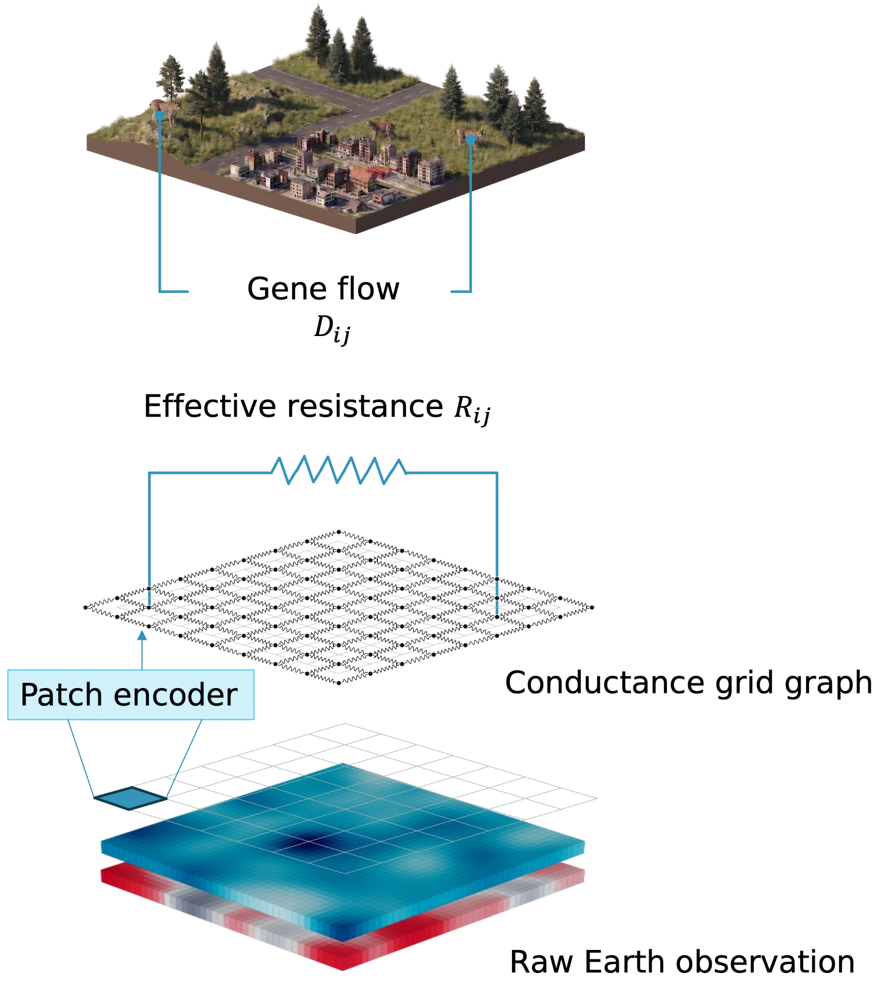
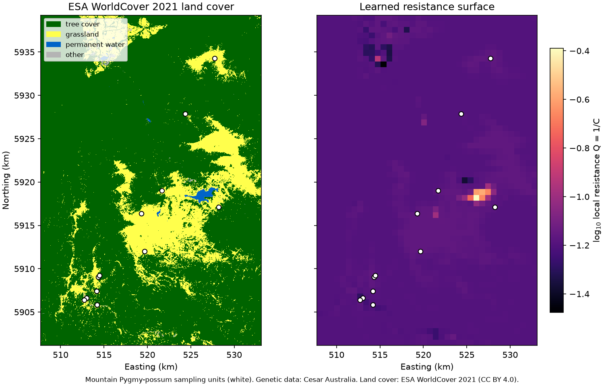

# ILG Toolkit

**Differentiable, GPU-accelerated utilities for inverse landscape genetics in JAX.**

[](https://github.com/vboussange/ilg-toolkit/actions/workflows/run_tests.yml)
[](https://github.com/vboussange/ilg-toolkit/actions/workflows/docs.yml)

Inverse landscape genetics (ILG) infers spatial ecological networks from
geolocated genetic data by learning a conductance grid graph whose edge weights
encode local landscape permeability to movement, so that the effective
resistances it induces between sampled populations predict their genetic
dissimilarity.

ILG Toolkit provides differentiable, GPU-accelerated utilities for ILG in JAX.
A patch encoder maps patches of landscape features to the vertex conductances of
the conductance grid graph, and is trained end-to-end through a differentiable
effective-resistance layer.

<p align="center">
  
</p>

- Log-linear and ResNet9 patch encoders, and a U-Net embedding-distance model.
- Effective resistance with gradients on a CPU or a GPU, through conjugate gradient
  preconditioned by geometric multigrid, plain conjugate gradient, or the NVIDIA
  CUDA Direct Sparse Solver (cuDSS).
- Training under complete pooling across regions, with a log1p loss or
  maximum-likelihood population effects (MLPE) for population dependence.
- Genetic calibration, conditional prediction, and ensembles on the target's
  original scale, with experimental multispecies support.

## Installation

Requires Python 3.12 or newer. Add the development version and the quickstart's
dependencies to a [uv](https://docs.astral.sh/uv/) project with:

```bash
uv add "ilg-toolkit[examples] @ git+https://github.com/vboussange/ilg-toolkit"
```

The `examples` extra installs rioxarray, pandas and Matplotlib for the examples.
The `cudss` extra installs the NVIDIA CUDA Direct Sparse Solver (cuDSS), one of
the [resistance solvers](#resistance-solvers).

ILG Toolkit runs on the device JAX selects. To run it on an NVIDIA GPU, add the
`cudss` extra, which installs cuDSS through [spineax](https://github.com/johnviljoen/spineax)
and JAX with CUDA 13 support:

```bash
uv add "ilg-toolkit[examples,cudss] @ git+https://github.com/vboussange/ilg-toolkit"
```

The `cudss` extra runs on Linux x86-64 with an NVIDIA GPU of compute capability 7.5
or newer. Two environment variables configure it:

- `XLA_PYTHON_CLIENT_PREALLOCATE=false` leaves GPU memory for cuDSS, which allocates
  its factorizations outside JAX's memory pool.
- `SPINEAX_FACTOR_CACHE` sets how many factorizations spineax keeps on the GPU, by
  default 8. With more than 8 raster shapes, set it to at least their number.

For CUDA 12, build spineax from source as in
[these notes](https://github.com/vboussange/jaxscape/issues/49#issuecomment-6501729059).

To run on an NVIDIA GPU with another resistance solver, install JAX with CUDA
support instead:

```bash
uv add "jax[cuda13]"
```

The [JAX installation guide](https://docs.jax.dev/en/latest/installation.html)
lists the CUDA versions and platforms JAX supports.

## Quickstart

The [quickstart](https://vboussange.github.io/ilg-toolkit/examples/quickstart/)
trains a log-linear patch encoder on pairwise Fst between 12 Mountain
Pygmy-possum sampling units in the Victorian Alps, kindly provided by
[Cesar Australia](https://cesaraustralia.com), and ESA WorldCover 2021 land
cover (CC BY 4.0). Run it on an NVIDIA GPU with uv and the `examples` and `cudss`
extras:

```bash
curl -O https://raw.githubusercontent.com/vboussange/ilg-toolkit/main/examples/quickstart.py
XLA_PYTHON_CLIENT_PREALLOCATE=false uv run \
  --with "ilg-toolkit[examples,cudss] @ git+https://github.com/vboussange/ilg-toolkit" \
  python quickstart.py
```

Without an NVIDIA GPU, omit the `cudss` extra and the environment variable to run
it on the CPU.

The script reads the land-cover GeoTIFF with rioxarray, turns it into land-cover
fractions, places the sampling units by their coordinates, selects cuDSS on a GPU
and JAXScape's default solver elsewhere, and trains the patch encoder from the best
uniform conductance:

```python
region = RegionBatch.from_points(
    "victorian-alps",
    cx.from_xarray(features),
    sampling_unit_ids=tuple(sites.index),
    coordinates=sites[["x", "y"]].to_numpy(),
)
observations = PairwiseObservations(
    tuple(fst.index),
    fst.to_numpy(),
    target=TargetSpec("pairwise Fst", units="proportion", transform="odds"),
)
loss = Log1pLoss()
solver = CuDSSSolver() if jax.default_backend() == "gpu" else None
distance_model = initialize_uniform_conductance(
    LogLinearConductance(in_channels=3, patch_size=PATCH_SIZE, solver=solver),
    region,
    observations,
    loss,
)
state = train(
    region,
    observations,
    distance_model=distance_model,
    config=TrainingConfig(loss=loss, steps=2000, eval_every=100),
)
conductance = state.selected_model.distance_model.conductance_surface(region)
resistance = 1 / conductance  # Local resistance Q = 1/C of each vertex.
```

<p align="center">
  
</p>

The quickstart runs in about 30 seconds on an NVIDIA RTX 3090.

Swap in `ResNet9Conductance` as a deep patch encoder that maps raw patches of
landscape features to vertex conductances, with the same `solver`.

## Resistance solvers

The resistance solver is the numerical method behind the effective-resistance
layer: a [Lineax](https://docs.kidger.site/lineax/) solver that a conductance model
carries in `solver`. [JAXScape](https://github.com/vboussange/jaxscape) provides
solvers for the grounded Laplacians of conductance grid graphs, in
`jaxscape.solvers`:

| Solver | Method | Installation | Choose it for |
| --- | --- | --- | --- |
| JAXScape's default (`solver=None`) | Conjugate gradient (CG) preconditioned with geometric multigrid | Included | A CPU, or a GPU without the `cudss` extra or when the cuDSS factorization does not fit in GPU memory |
| `CuDSSSolver()` | cuDSS, a sparse direct solver | `cudss` extra | An NVIDIA GPU, at any conductance contrast, when the factorization fits in GPU memory |

Their settings are JAXScape's. Iterative solvers, such as JAXScape's default solver
and Lineax's `CG`, raise an error when they reach their iteration limit. The
iterations of the default solver grow on conductance surfaces that vary by orders of
magnitude from one vertex to the next. `CuDSSSolver` has no iteration limit, and its
cost does not depend on conductance contrast. A deep patch encoder can drive
conductance to its floor, so train one with `CuDSSSolver` on an NVIDIA GPU. The
[API reference](https://vboussange.github.io/ilg-toolkit/api/models/#resistance-solvers)
describes solver state, failures and saved models.

## Documentation

See the [documentation](https://vboussange.github.io/ilg-toolkit/) for the
examples, the glossary, and the API reference.

## Contributing

See [CONTRIBUTING.md](https://github.com/vboussange/ilg-toolkit/blob/main/CONTRIBUTING.md)
for development checks and documentation conventions.

## Interpreting results

Interpret learned resistance surfaces, ecological distances and genetic
predictions with care, in light of each study's design and data. The authors and
contributors of ILG Toolkit accept no responsibility for results obtained with it
or for decisions based on them.

## License

Developed by Victor Boussange and contributors. Licensed under the
[Apache License 2.0](https://github.com/vboussange/ilg-toolkit/blob/main/LICENSE).

## Acknowledgements

Development of ILG Toolkit was supported by the Swiss National Science Foundation
(SNSF), grant 237783.
