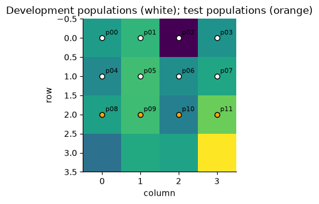
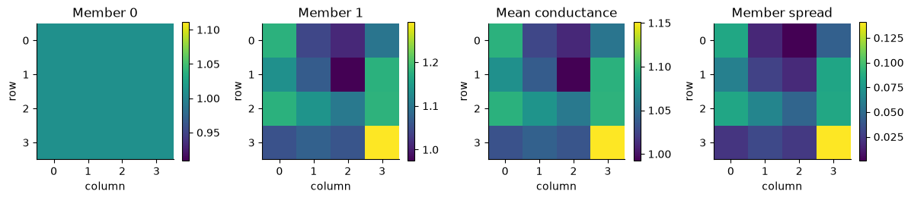

# Ensembles: train, select, and inspect members

[View `ensemble.ipynb` on GitHub](https://github.com/vboussange/ilg-toolkit/blob/main/examples/ensemble.ipynb)

How sensitive is an estimated landscape relationship to the populations used for training and
selection? This notebook trains two conductance models with different population splits,
selects each frozen distance representation using fresh validation calibration, and collects
the fitted models in an ordered `Ensemble`.

> **Note:** The notebook owns splits, seeds, checkpoints, and selection. The ensemble only combines compatible
> fitted models. We reserve one common test population set before training, then use its observations
> to fit and score each frozen representation. This is an **explanatory association assessment**;
> the final test-fitted predictions are not a population-holdout evaluation of predictive accuracy.

For the statistical reasoning and other prediction modes, read the
[maximum-likelihood population effects (MLPE) workflow](mlpe_workflow.md). Here the emphasis is a complete, reproducible member-training loop.


```python
from dataclasses import replace
from itertools import combinations
from pathlib import Path
from tempfile import TemporaryDirectory

import coordax as cx
import jax
import matplotlib.pyplot as plt
import numpy as np
from ilg_toolkit import (
    calibrate,
    Ensemble,
    load_checkpoint,
    MLPELoss,
    PairwiseObservations,
    RegionBatch,
    save_checkpoint,
    TargetSpec,
    train,
    TrainingConfig,
)
from ilg_toolkit.mlpe import calibrate_mlpe
from ilg_toolkit.models import LogLinearConductance
from IPython.display import display, Markdown


jax.config.update("jax_enable_x64", True)
plt.rcParams.update({"axes.spines.top": False, "axes.spines.right": False})
rng = np.random.default_rng(42)
```

## A shared landscape and disjoint population sets

> **Note:** Twelve populations occupy distinct cells in a 4 × 4 landscape. Genetic measurements contain
> a geographic trend, a landscape-feature difference, population effects, and pair noise. This synthetic
> generator is a teaching device; it does not make the conductance model the true data-generating
> process.

The final four populations are reserved for test calibration. Each member divides the remaining
eight into four training and four validation populations. Every selected pair has both endpoints
inside its population set. `select_pairs` preserves the original sampling-unit ordering, so the
same full `RegionBatch` supplies locations throughout.


```python
positions = np.array([(r, c) for r in range(4) for c in range(4)])[:12]
labels = tuple(f"p{i:02}" for i in range(len(positions)))
features = rng.normal(size=(4, 4, 2))
region = RegionBatch(
    "ensemble-valley",
    cx.field(features, "row", "column", "feature"),
    labels,
    positions,
    feature_names=("canopy", "moisture"),
)
pair_labels = tuple(combinations(labels, 2))
lookup = {label: index for index, label in enumerate(labels)}
left = np.array([lookup[a] for a, _ in pair_labels])
right = np.array([lookup[b] for _, b in pair_labels])
geographic = np.linalg.norm(positions[left] - positions[right], axis=1)
canopy = features[positions[:, 0], positions[:, 1], 0]
population_effects = rng.normal(0, 0.025, len(labels))
model_targets = (
    0.45
    + 0.08 * geographic
    + 0.04 * np.abs(canopy[left] - canopy[right])
    + population_effects[left]
    + population_effects[right]
    + rng.normal(0, 0.025, len(pair_labels))
)
observations = PairwiseObservations.from_pairs(
    pair_labels,
    np.expm1(model_targets),
    sampling_unit_ids=labels,
    target=TargetSpec("synthetic divergence", units="index", transform="log1p"),
)
development_ids, test_ids = labels[:8], labels[8:]


def within(ids):
    selected = set(ids)
    return observations.select_pairs(
        [pair for pair in observations.observed_pairs if set(pair).issubset(selected)]
    )


def geographic_distances(observed):
    return np.array(
        [
            np.linalg.norm(positions[lookup[a]] - positions[lookup[b]])
            for a, b in observed.observed_pairs
        ]
    )


fig, ax = plt.subplots(figsize=(6, 3.5))
ax.imshow(features[..., 0], cmap="viridis")
for label, (r, c) in zip(labels, positions, strict=True):
    ax.scatter(c, r, color="white" if label in development_ids else "orange", edgecolor="black")
    ax.annotate(label, (c, r), xytext=(4, 4), textcoords="offset points", fontsize=8)
ax.set(
    title="Development populations (white); test populations (orange)",
    xlabel="column",
    ylabel="row",
)
fig.tight_layout()
plt.show()
```


    

    


## Train each member and select frozen candidates

Both members use the same loss settings and standalone calibration budget. For each validation
set we fit a geographic baseline once, then evaluate candidates at updates 0, 2, and 4. The
criterion is landscape marginal log likelihood minus geographic marginal log likelihood; larger
is better. All baseline distances follow the observations' pair order.

Each member first trains for two updates, reloads its checkpoint using a matching model
template, and continues to four **total** updates. The callback resumes at update 3, so
candidate steps 0, 2, and 4 each occur once. The same `chosen` dictionary and
`candidate_records` list retain selection results across the two training calls.

> **Note:** No `validation=` argument is passed to `train`: its built-in validation holds training calibration
> fixed and answers a different question. The dictionary `chosen` retains this notebook's selected
> distance model, separately from `TrainingState.selected_model`.

> **Note:** Seeds determine population splits here. `LogLinearConductance` starts at zero coefficients;
> the members differ through their observations rather than a hidden initialization policy.


```python
loss = MLPELoss()
max_iterations = 2000
workspace = TemporaryDirectory()
artifact_dir = Path(workspace.name)
members, candidate_records, checkpoints = [], [], []
seeds = (13, 29)

for member_index, seed in enumerate(seeds):
    permutation = np.random.default_rng(seed).permutation(development_ids)
    training = within(permutation[:4])
    validation = within(permutation[4:])
    baseline = calibrate_mlpe(
        geographic_distances(validation),
        validation,
        region_name=region.name,
        loss=loss,
        max_iterations=max_iterations,
    )
    chosen = {"score": -np.inf, "distance_model": None, "step": None}
    checkpoint = artifact_dir / f"member-{member_index}.eqx"

    def on_step(
        state,
        *,
        checkpoint=checkpoint,
        validation=validation,
        baseline=baseline,
        member_index=member_index,
        chosen=chosen,
    ):
        save_checkpoint(checkpoint, state)
        if state.step % 2:
            return
        candidate = state.latest_model.distance_model
        fitted = calibrate(region, validation, candidate, loss=loss, max_iterations=max_iterations)
        calibration = fitted.calibration.for_region(region.name)
        score = calibration.ml_log_likelihood - baseline.ml_log_likelihood
        candidate_records.append((member_index, state.step, score, calibration.slope))
        if score > chosen["score"]:
            chosen.update(score=score, distance_model=candidate, step=state.step)

    state = train(
        region,
        training,
        distance_model=LogLinearConductance(2, patch_size=1),
        config=TrainingConfig(loss=loss, steps=2, eval_every=2, learning_rate=0.02, seed=seed),
        on_step=on_step,
    )
    restored = load_checkpoint(checkpoint, distance_model=LogLinearConductance(2, patch_size=1))
    state = train(
        region,
        training,
        state=restored,
        config=replace(restored.config, steps=4),
        on_step=on_step,
    )
    print(f"Member {member_index}: resumed update {restored.step} through {state.step}")
    members.append(
        {
            "seed": seed,
            "training": training,
            "validation": validation,
            "distance_model": chosen["distance_model"],
            "selected_step": chosen["step"],
            "validation_score": chosen["score"],
        }
    )
    checkpoints.append(checkpoint)

rows = [
    "| Member position | Update | Validation likelihood improvement | Signed slope |",
    "| ---: | ---: | ---: | ---: |",
]
rows += [
    f"| {member} | {step} | {score:.3f} | {slope:.3f} |"
    for member, step, score, slope in candidate_records
]
display(Markdown("\n".join(rows)))
```

    Member 0: resumed update 2 through 4


    Member 1: resumed update 2 through 4


| Member position | Update | Validation likelihood improvement | Signed slope |
| ---: | ---: | ---: | ---: |
| 0 | 0 | 1.125 | 0.038 |
| 0 | 2 | 1.013 | 0.038 |
| 0 | 4 | 0.884 | 0.037 |
| 1 | 0 | -0.425 | 0.004 |
| 1 | 2 | -0.425 | 0.004 |
| 1 | 4 | -0.424 | 0.004 |


> **Note:** The stored checkpoints contain each run's latest state, not the dictionary used for this
> notebook's separate selection criterion. Keep the selected distance model and selection table
> with the study's results. A resumed candidate-selection study also needs its prior best score
> and chosen model; those are ordinary study artifacts, not ensemble bookkeeping.

Inspecting a saved state requires the same distance-model template and float64 setting.
The final saved state below includes all four updates from the continuation above.


```python
restored = load_checkpoint(checkpoints[0], distance_model=LogLinearConductance(2, patch_size=1))
print("Saved checkpoint filenames:", [path.name for path in checkpoints])
print("First member latest update:", restored.step)
print("Built-in selected update:", restored.selected_step)
print("Notebook-selected update:", members[0]["selected_step"])
```

    Saved checkpoint filenames: ['member-0.eqx', 'member-1.eqx']
    First member latest update: 4
    Built-in selected update: 4
    Notebook-selected update: 0


## Freeze the selected distances, then assess test association

Candidate selection is finished. Only now do we select the test measurements, fit fresh
calibration for each frozen distance model, and compare with the matching geographic MLPE
baseline. The same target transform, pairs, loss settings, covariance assumptions, and iteration
budget are used for all fits.

> **Note:** Inspect the signed slopes as well as the likelihood improvements. A favorable score with an
> unexpected slope can reveal a scientifically unsuitable relationship. The two members share
> one test population set, so their scores are paired descriptive comparisons, not independent
> replicates or a significance test.


```python
frozen_distances = tuple(member["distance_model"] for member in members)
test_observations = within(test_ids)
geographic_fit = calibrate_mlpe(
    geographic_distances(test_observations),
    test_observations,
    region_name=region.name,
    loss=loss,
    max_iterations=max_iterations,
)
fitted_models = [
    calibrate(region, test_observations, distance_model, loss=loss, max_iterations=max_iterations)
    for distance_model in frozen_distances
]

rows = [
    "| Member | Selected update | Test likelihood improvement | Slope | "
    "Population variance | Residual variance | Converged |",
    "| ---: | ---: | ---: | ---: | ---: | ---: | :---: |",
]
for index, model in enumerate(fitted_models):
    fitted = model.calibration.for_region(region.name)
    rows.append(
        f"| {index} | {members[index]['selected_step']} | "
        f"{fitted.ml_log_likelihood - geographic_fit.ml_log_likelihood:.3f} | "
        f"{fitted.slope:.3f} | {fitted.unit_variance:.5f} | "
        f"{fitted.residual_variance:.5f} | {fitted.converged} |"
    )
display(Markdown("\n".join(rows)))
print(
    f"Each test fit uses {len(geographic_fit.population_ids)} populations and "
    f"{len(test_observations.observed_pairs)} pairs."
)
print(
    f"Geographic baseline: slope={geographic_fit.slope:.3f}, "
    f"population variance={geographic_fit.unit_variance:.5f}, "
    f"residual variance={geographic_fit.residual_variance:.5f}, "
    f"converged={geographic_fit.converged}"
)
```


| Member | Selected update | Test likelihood improvement | Slope | Population variance | Residual variance | Converged |
| ---: | ---: | ---: | ---: | ---: | ---: | :---: |
| 0 | 0 | 0.187 | 0.082 | 0.00022 | 0.00000 | True |
| 1 | 4 | 0.510 | 0.080 | 0.00019 | 0.00000 | True |


    Each test fit uses 4 populations and 6 pairs.
    Geographic baseline: slope=0.080, population variance=0.00019, residual variance=0.00001, converged=True


## Construct and use the ensemble

> **Note:** `Ensemble` snapshots an ordered list or tuple of compatible fitted models. Member position 0
> is the first supplied model. It checks target, feature, and species contracts and reports a
> member's position if prediction fails; it does not silently drop that member.

> **Note:** Each member inverse-transforms its own genetic prediction before averaging. This matters for
> our log1p target transform: the mean of original-scale predictions generally differs from an
> inverse transform applied after averaging on the model scale. Individual point predictions are
> inverse-transformed fitted means, not automatically original-scale expectations.


```python
ensemble = Ensemble(fitted_models)
result = ensemble.predict(region, pairs=test_observations.observed_pairs)
rows = [
    "| Test pair | Observed | Member 0 | Member 1 | Ensemble mean | Member spread |",
    "| --- | ---: | ---: | ---: | ---: | ---: |",
]
for index, pair in enumerate(result.prediction.pairs):
    rows.append(
        f"| {' – '.join(pair)} | {float(test_observations.observed_values[index]):.3f} | "
        f"{float(result.member_values[0, index]):.3f} | "
        f"{float(result.member_values[1, index]):.3f} | "
        f"{float(result.prediction.values[index]):.3f} | "
        f"{float(result.member_spread[index]):.3f} |"
    )
display(Markdown("\n".join(rows)))
print("Member positions:", result.member_ids)
```


| Test pair | Observed | Member 0 | Member 1 | Ensemble mean | Member spread |
| --- | ---: | ---: | ---: | ---: | ---: |
| p08 – p09 | 0.749 | 0.726 | 0.727 | 0.726 | 0.000 |
| p08 – p10 | 0.876 | 0.911 | 0.915 | 0.913 | 0.002 |
| p08 – p11 | 1.064 | 1.102 | 1.092 | 1.097 | 0.005 |
| p09 – p10 | 0.752 | 0.715 | 0.724 | 0.720 | 0.005 |
| p09 – p11 | 0.943 | 0.911 | 0.908 | 0.910 | 0.002 |
| p10 – p11 | 0.703 | 0.726 | 0.726 | 0.726 | 0.000 |


    Member positions: (0, 1)


> **Note:** `member_spread` is descriptive population standard deviation across members. It is not a
> calibrated confidence interval or predictive uncertainty for a new genetic observation.
> Because these calibrations were estimated on the test observations, this table visualizes
> fitted association; it must not be reported as a population-holdout evaluation of predictive accuracy.

## Inspect conductance variation

> **Note:** Conductance summaries preserve the same member order. Variation between these surfaces
> reflects the chosen population splits and short optimization runs. A stable mean surface
> does not by itself identify a causal movement mechanism, and its variability omits many
> sources of uncertainty in data and study design.


```python
surfaces = ensemble.conductance_surfaces(region)
fig, axes = plt.subplots(1, 4, figsize=(12, 3))
panels = [
    surfaces.member_values[0],
    surfaces.member_values[1],
    surfaces.values,
    surfaces.member_spread,
]
titles = ["Member 0", "Member 1", "Mean conductance", "Member spread"]
for ax, values, title in zip(axes, panels, titles, strict=True):
    image = ax.imshow(values, cmap="viridis")
    ax.set(title=title, xlabel="column", ylabel="row")
    fig.colorbar(image, ax=ax, shrink=0.7)
fig.tight_layout()
plt.show()
workspace.cleanup()
```


    

    


## Adapt the study design

More members require scientifically motivated resampling and a sufficient population count.
Keep a record of population sets, seeds, numerical settings, selected candidates, and checkpoint
paths in study code. Repeat matched landscape/geographic assessments across test population
splits to study variability, as the [MLPE workflow](mlpe_workflow.md) demonstrates.

> **Note:** The ensemble's mean is an aggregate prediction, not another fitted MLPE model: this notebook
> does not assign it a marginal MLPE likelihood. For a population-holdout evaluation of genetic
> predictions, retain training-fitted calibration and score observations not used for either selection or
> calibration, with a study-appropriate treatment of population dependence.
