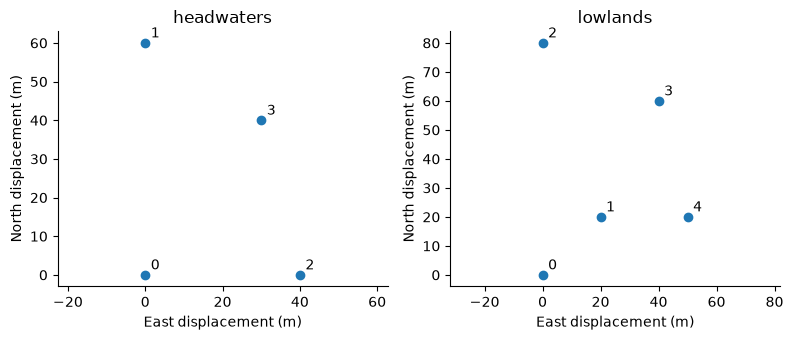
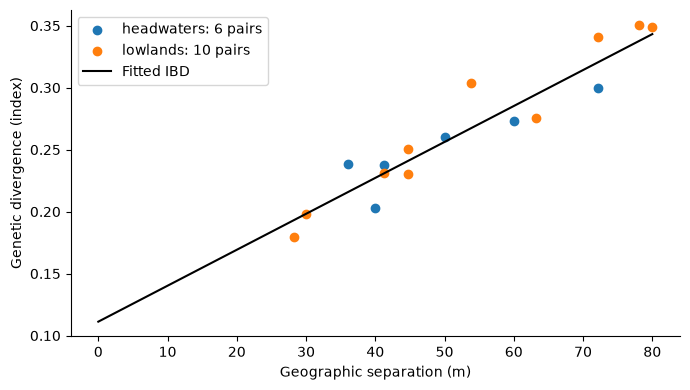
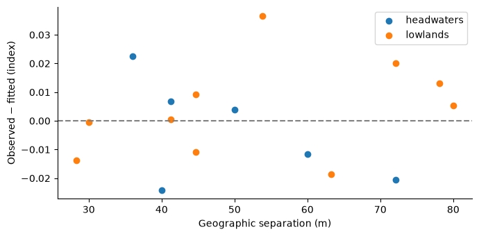

# Isolation-by-distance model: a geographic reference

[View `ibd.ipynb` on GitHub](https://github.com/vboussange/ilg-toolkit/blob/main/examples/ibd.ipynb)

Does geographic separation alone explain a useful part of the observed genetic pattern?
An isolation-by-distance (IBD) model provides a reference before attributing a pattern
to habitat or landscape resistance. Here we fit a common relationship across two synthetic
regions and examine their residuals.

> **Note:** `IBDModel` fits nonnegative slope and intercept using its direct log1p criterion, with equal
> regional influence. It does not model population dependence. The geographic **maximum-likelihood population effects (MLPE) likelihood**
> comparison in the [MLPE workflow](mlpe_workflow.md) uses the shared MLPE distance-vector fitter
> instead; scores from these different criteria are not interchangeable.


```python
from itertools import combinations

import jax
import matplotlib.pyplot as plt
import numpy as np
from ilg_toolkit import IBDModel, TargetSpec
from IPython.display import display, Markdown


jax.config.update("jax_enable_x64", True)
rng = np.random.default_rng(18)
plt.rcParams.update({"axes.spines.top": False, "axes.spines.right": False})
```

## Put geographic distances in physical units

> **Note:** Raster row and column indices are not distances. These synthetic cells are 20 m high and
> 10 m wide, so we scale each axis before computing Euclidean separation. For real data,
> use a suitable projected coordinate system and the raster's spatial transform; treating
> longitude and latitude as meters would change the scientific meaning.

The population IDs establish pair alignment. Each response vector uses exactly the same
upper-triangle pair order as its distance vector. The two regions intentionally have
different numbers of populations and therefore different numbers of measured pairs.


```python
pixel_size_m = np.array([20.0, 10.0])
positions = {
    "headwaters": np.array([[0, 0], [3, 0], [0, 4], [2, 3]]),
    "lowlands": np.array([[0, 0], [1, 2], [4, 0], [3, 4], [1, 5]]),
}
distance_matrices, distances, pairs, targets = {}, {}, {}, {}
target = TargetSpec("synthetic genetic divergence", units="index")
for name, grid in positions.items():
    points = grid * pixel_size_m
    matrix = np.linalg.norm(points[:, None, :] - points[None, :, :], axis=-1)
    ids = tuple(f"{name}-{i}" for i in range(len(grid)))
    distance_matrices[name] = matrix
    distances[name] = matrix[np.triu_indices(len(grid), 1)]
    pairs[name] = tuple(combinations(ids, 2))
    targets[name] = 0.1 + 0.003 * distances[name] + rng.normal(0, 0.015, len(pairs[name]))

fig, axes = plt.subplots(1, 2, figsize=(8, 3.5))
for ax, (name, grid) in zip(axes, positions.items(), strict=True):
    points = grid * pixel_size_m
    ax.scatter(points[:, 1], points[:, 0])
    for index, (north, east) in enumerate(points):
        ax.annotate(str(index), (east, north), xytext=(4, 4), textcoords="offset points")
    ax.set(title=name, xlabel="East displacement (m)", ylabel="North displacement (m)")
    ax.set_aspect("equal", adjustable="datalim")
fig.tight_layout()
plt.show()
```


    

    


## Fit one geographic relationship across regions

> **Note:** Both regions receive equal weight, rather than weighting the region with more pairs more
> heavily. Target units stay in index units and the target transform is the identity.
> The slope's units are index units per meter. See the [IBD API](../api/ibd.md) for the
> criterion and input contracts.


```python
model = IBDModel.fit(distances, targets, distance_units="m", target=target)
print(f"Slope: {model.slope:.6f} index/m")
print(f"Intercept: {model.intercept:.4f} index")

line = np.linspace(0, max(values.max() for values in distances.values()), 100)
fig, ax = plt.subplots(figsize=(7, 4))
for name in positions:
    ax.scatter(distances[name], targets[name], label=f"{name}: {len(pairs[name])} pairs")
ax.plot(line, model.predict(line, distance_units="m"), color="black", label="Fitted IBD")
ax.set(xlabel="Geographic separation (m)", ylabel="Genetic divergence (index)")
ax.legend()
fig.tight_layout()
plt.show()
```

    Slope: 0.002900 index/m
    Intercept: 0.1112 index


    

    


## Examine fit within each region

> **Note:** Residuals can reveal patterns that a single geographic relationship misses. The quantities
> below describe the same data used to estimate the coefficients. They are descriptive fit
> summaries, not population-holdout evaluation scores or significance tests. Pairs sharing populations
> are dependent; treating every plotted point as an independent replicate would overstate
> the information in this example.


```python
rows = [
    "| Region | Populations | Pairs | RMSE (index) | Mean residual (index) |",
    "| --- | ---: | ---: | ---: | ---: |",
]
fig, ax = plt.subplots(figsize=(7, 3.5))
for name in positions:
    fitted = np.asarray(model.predict(distances[name], distance_units="m"))
    residual = targets[name] - fitted
    rows.append(
        f"| {name} | {len(positions[name])} | {len(pairs[name])} | "
        f"{np.sqrt(np.mean(residual**2)):.4f} | {residual.mean():.4f} |"
    )
    ax.scatter(distances[name], residual, label=name)
ax.axhline(0, color="gray", linestyle="--")
ax.set(xlabel="Geographic separation (m)", ylabel="Observed − fitted (index)")
ax.legend()
fig.tight_layout()
plt.show()
display(Markdown("\n".join(rows)))
```


    

    


| Region | Populations | Pairs | RMSE (index) | Mean residual (index) |
| --- | ---: | ---: | ---: | ---: |
| headwaters | 4 | 6 | 0.0169 | -0.0039 |
| lowlands | 5 | 10 | 0.0164 | 0.0041 |


## Predict a vector or matrix of separations

Vector predictions preserve the input distance order. `IBDModel` also accepts a square distance
matrix and sets its diagonal to structural zero. This array interface is specific to IBD;
the landscape models' labeled `Prediction` matrices use `NaN` on the diagonal.

> **Note:** Prediction distances must remain in the fitted units. To use kilometers, refit with converted
> distances and a matching units declaration; changing the units string alone is not a conversion.


```python
new_separations_m = np.array([15.0, 45.0, 80.0])
print("Requested separations (m):", new_separations_m)
print("Predictions (index):", np.asarray(model.predict(new_separations_m, distance_units="m")))
print("Lowlands prediction matrix:")
print(np.round(model.predict(distance_matrices["lowlands"], distance_units="m"), 3))
```

    Requested separations (m): [15. 45. 80.]


    Predictions (index): [0.15473827 0.24172388 0.34320708]
    Lowlands prediction matrix:


    [[0.    0.193 0.343 0.32  0.267]
     [0.193 0.    0.295 0.241 0.198]
     [0.343 0.295 0.    0.241 0.338]
     [0.32  0.241 0.241 0.    0.231]
     [0.267 0.198 0.338 0.231 0.   ]]


## Interpretation and next step

> **Note:** These synthetic observations were generated with a geographic trend, so a positive fitted
> slope is expected. In a study, such a trend may reflect spatial processes that are correlated
> with landscape features. An improved landscape fit alone does not establish causation.

For a like-for-like likelihood comparison with a trained distance representation, continue
to the [MLPE workflow](mlpe_workflow.md). It fits landscape and geographic relationships using
the same observations, target transformation, covariance assumptions, and optimization settings,
then compares their marginal likelihoods within matching population splits.
