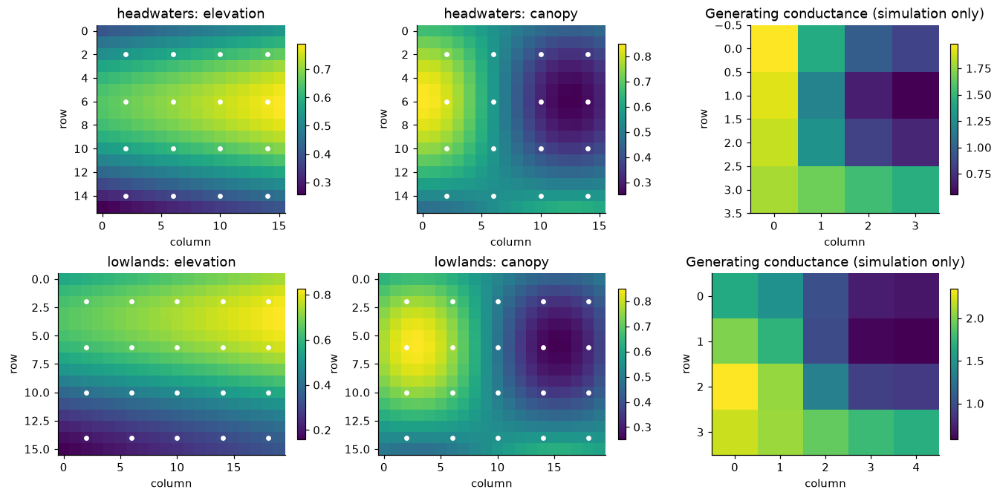
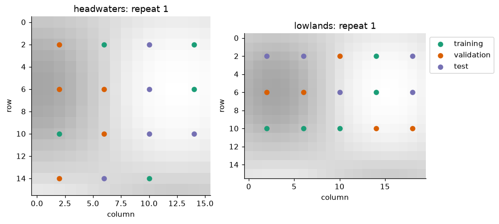
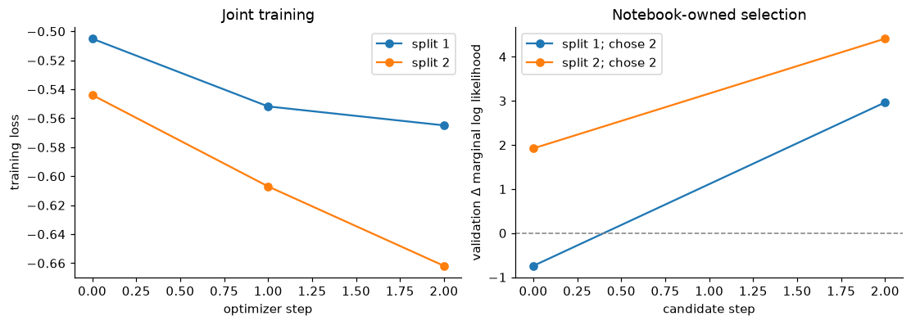
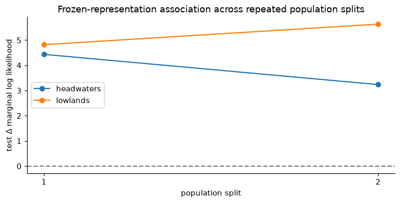
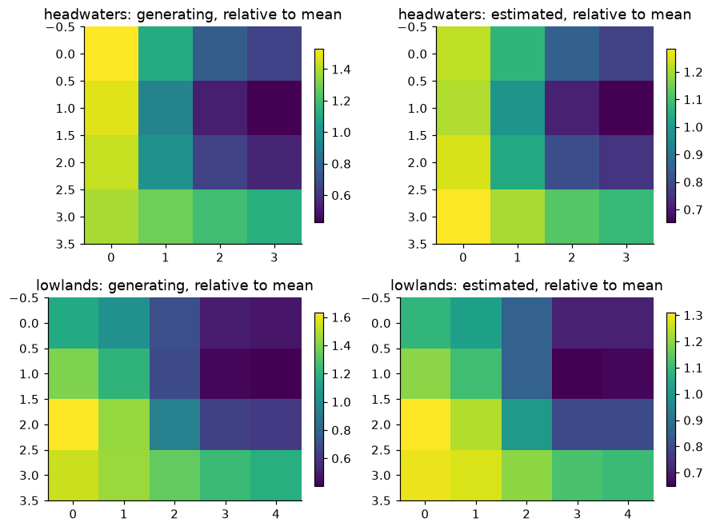
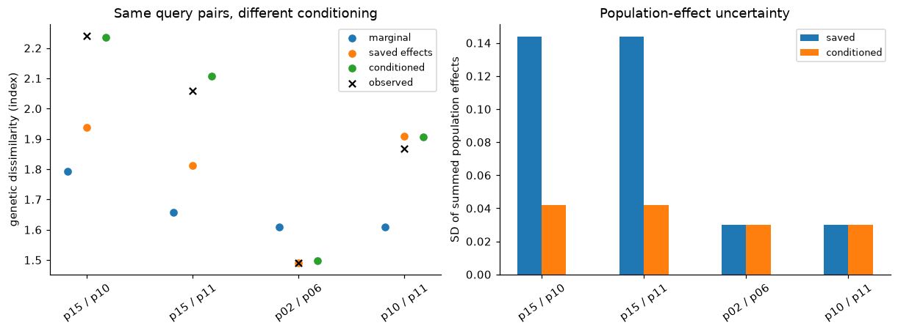
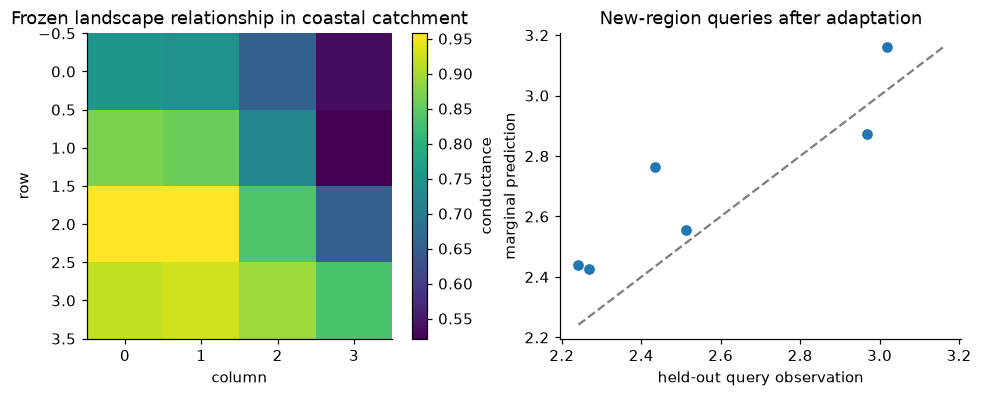

# Maximum-likelihood population effects (MLPE): training landscape models, assessing association, and transferring calibration

[View `mlpe_workflow.ipynb` on GitHub](https://github.com/vboussange/ilg-toolkit/blob/main/examples/mlpe_workflow.ipynb)

Can a landscape relationship estimated from two regions explain genetic dissimilarity among populations whose genetic measurements were withheld from training? This tutorial follows that question from synthetic landscapes through a ResNet9 patch encoder, fresh MLPE calibration, explanatory evaluation on withheld populations, conditional prediction, and transfer to a third region.

We train **one patch encoder across regions** (complete pooling) and keep a **group-specific genetic calibration** for each region. Landscape features and sampling locations are available throughout; genetic observations determine what can be used for training, selection, or assessment. We repeat the complete population split twice and retain our own validation-selected distance model.

> **Note:** The small deterministic example is intended to make the statistical operations inspectable on CPU. Two optimizer updates are a demonstration budget, not evidence that a large neural network is well identified. Real analyses require adequate population replication, biologically justified features and spatial extent, longer training, and sensitivity analyses.


```python
import os


os.environ["JAX_ENABLE_X64"] = "true"

from itertools import combinations
from pathlib import Path
from tempfile import TemporaryDirectory

import coordax as cx
import jax
import jax.numpy as jnp
import matplotlib.pyplot as plt
import numpy as np
from ilg_toolkit import (
    calibrate,
    load_model,
    MLPELoss,
    PairwiseObservations,
    RegionBatch,
    ResistanceSolverConfig,
    save_model,
    TargetSpec,
    train,
    TrainingConfig,
)
from ilg_toolkit.mlpe import calibrate_mlpe
from ilg_toolkit.models import LogLinearConductance, ResNet9Conductance
from ilg_toolkit.models.base import prepare_distance_context
from ilg_toolkit.resistance import effective_resistance
from IPython.display import display, Markdown


jax.config.update("jax_enable_x64", True)
plt.rcParams.update({"figure.dpi": 110, "axes.spines.top": False, "axes.spines.right": False})


def table(rows, columns=None):
    """Display small result tables without requiring a dataframe dependency."""
    columns = list(rows[0]) if columns is None else columns

    def format_value(value):
        if isinstance(value, (float, np.floating)):
            return f"{value:.4g}"
        return str(value)

    lines = [" | ".join(columns), " | ".join("---" for _ in columns)]
    lines += [" | ".join(format_value(row[column]) for column in columns) for row in rows]
    display(Markdown("\n".join(lines)))


print("Devices:", jax.devices(), "— float64:", jax.config.read("jax_enable_x64"))
```

    Devices: [CudaDevice(id=0)] — float64: True


## 1. Landscapes, populations, and a known data-generating relationship

> **Note:** Our features are synthetic elevation and canopy cover with common meanings and channel order in both regions. Each 4×4 raster patch becomes one vertex of the conductance grid graph. Populations occupy distinct patch centers, so patch aggregation never merges their locations. Headwaters and lowlands have different extents.

> **Note:** For simulation only, a known positive conductance surface generates effective resistance on a four-neighbor grid. Genetic dissimilarity is an intercept plus a positive standardized-resistance contribution, one random effect for each endpoint population, and pair-specific noise. The two regions have different intercepts and effect sizes. This gives us a controlled example for complete pooling with group-specific calibration: one landscape mechanism, with a separate genetic relationship in each region. The training code never sees the generating conductance surface or its parameters.

We use an identity target transform, so model-scale quantities and returned predictions have the same index units. MLPE assumes Gaussian additive population effects and residuals on the chosen model scale; population effects induce dependence among pairs sharing endpoints. These assumptions need substantive justification for real genetic measurements.


```python
PATCH_SIZE = 4
PIXEL_KM = 0.25
TARGET = TargetSpec("synthetic genetic dissimilarity", units="index", transform="identity")
SOLVER = ResistanceSolverConfig(rtol=1e-8, atol=1e-10, max_steps=1000)
LOSS = MLPELoss(variance_floor=1e-10, jitter=0.0)
CALIBRATION_ITERATIONS = 2000


def synthetic_region(name, *, seed, phase, columns=4, intercept=2.0, slope=0.3):
    rng = np.random.default_rng(seed)
    row, column = jnp.mgrid[: 4 * PATCH_SIZE, : columns * PATCH_SIZE]
    elevation = 0.4 + 0.25 * jnp.sin(row / 4 + phase) + 0.15 * column / 16
    canopy = 0.55 + 0.3 * jnp.cos(column / 4 - phase) * jnp.sin((row + 2) / 5)
    features = jnp.stack((elevation, canopy), axis=-1).astype(jnp.float32)
    patch_row, patch_column = np.mgrid[:4, :columns]
    positions = np.column_stack((patch_row.ravel(), patch_column.ravel())) * PATCH_SIZE + 2
    ids = tuple(f"{name}-p{i:02d}" for i in range(len(positions)))
    region = RegionBatch(
        name,
        cx.field(features, "row", "column", "feature"),
        ids,
        positions,
        feature_names=("elevation", "canopy"),
    )
    patch_features = features.reshape(4, PATCH_SIZE, columns, PATCH_SIZE, 2).mean(axis=(1, 3))
    true_conductance = jnp.exp(2.0 * patch_features[..., 1] - 1.5 * patch_features[..., 0])
    # A complete small resistance matrix is useful for simulation, not required for prediction.
    solver = prepare_distance_context(
        LogLinearConductance(2, patch_size=PATCH_SIZE, solver_config=SOLVER), features
    )
    true_resistance = effective_resistance(
        true_conductance.astype(jnp.float64), jnp.arange(len(ids)), context=solver
    )
    left, right = np.triu_indices(len(ids), 1)
    distances = np.asarray(true_resistance)[left, right]
    effects = rng.normal(0.0, 0.10, len(ids))
    effects[15] = 0.30  # Reserved population: never part of training or split assessment.
    values = (
        intercept
        + slope * (distances - distances.mean()) / distances.std(ddof=1)
        + effects[left]
        + effects[right]
        + rng.normal(0.0, 0.035, len(left))
    )
    observations = PairwiseObservations.from_pairs(
        tuple((ids[i], ids[j]) for i, j in zip(left, right, strict=True)),
        values,
        sampling_unit_ids=ids,
        target=TARGET,
    )
    return region, observations, true_conductance


study_inputs = [
    synthetic_region("headwaters", seed=21, phase=0.0, intercept=2.0, slope=0.30),
    synthetic_region("lowlands", seed=22, phase=0.7, columns=5, intercept=2.5, slope=0.22),
]
regions = [entry[0] for entry in study_inputs]
all_observations = [entry[1] for entry in study_inputs]

table(
    [
        {
            "region": region.name,
            "raster": str(region.feature_array.shape),
            "conductance grid": str(truth.shape),
            "located populations": len(region.sampling_unit_ids),
            "simulated pairs": len(observations.observed_pairs),
        }
        for region, observations, truth in study_inputs
    ]
)
```


region | raster | conductance grid | located populations | simulated pairs
--- | --- | --- | --- | ---
headwaters | (16, 16, 2) | (4, 4) | 16 | 120
lowlands | (16, 20, 2) | (4, 5) | 20 | 190


```python
fig, axes = plt.subplots(2, 3, figsize=(12, 6), constrained_layout=True)
for row_index, (region, _, true_conductance) in enumerate(study_inputs):
    for feature_index, label in enumerate(region.feature_names):
        artist = axes[row_index, feature_index].imshow(region.feature_array[..., feature_index])
        positions = np.asarray(region.grid_positions)
        axes[row_index, feature_index].scatter(positions[:, 1], positions[:, 0], s=12, c="white")
        axes[row_index, feature_index].set_title(f"{region.name}: {label}")
        fig.colorbar(artist, ax=axes[row_index, feature_index], shrink=0.8)
    artist = axes[row_index, 2].imshow(true_conductance, cmap="viridis")
    axes[row_index, 2].set_title("Generating conductance (simulation only)")
    fig.colorbar(artist, ax=axes[row_index, 2], shrink=0.8)
for axis in axes.flat:
    axis.set(xlabel="column", ylabel="row")
plt.show()
```


    

    


## 2. Split populations before selecting observations

Each repeat randomly assigns the first 15 populations in **each region** to disjoint groups of five training, five validation, and five test populations. A subset contains only pairs with **both endpoints** in its assigned group: ten pairs per group and region. Cross-group pairs and remaining populations are withheld. This avoids a pairwise split that lets the same population contribute genetic information to multiple roles.

> **Note:** `select_pairs` retains the original sampling-unit order. We therefore keep the complete `RegionBatch`, which supplies landscape features and locations but no genetic targets. Availability of that landscape context is a study assumption, not use of held-out genetic observations. Population p15 is reserved for the later support-conditioning example and never appears in these splits.

> **Note:** The two repeats share the same underlying simulated data and are not independent experiments. Their spread will be a descriptive sensitivity summary, not a confidence interval.


```python
SPLIT_SEEDS = (101, 202)


def population_split(seed):
    rng = np.random.default_rng(seed)
    selected = {role: [] for role in ("training", "validation", "test")}
    memberships = []
    for region, observations in zip(regions, all_observations, strict=True):
        shuffled = rng.permutation(region.sampling_unit_ids[:15])
        membership = {}
        for role, labels in zip(selected, np.split(shuffled, 3), strict=True):
            # Within-role pairs only; select_pairs preserves target metadata.
            labels = tuple(sorted(labels.tolist()))
            selected[role].append(observations.select_pairs(tuple(combinations(labels, 2))))
            membership[role] = labels
        memberships.append(membership)
    return selected, memberships


first_split, first_memberships = population_split(SPLIT_SEEDS[0])
table(
    [
        {
            "region": region.name,
            "role": role,
            "populations": len(membership[role]),
            "pairs": len(first_split[role][region_index].observed_pairs),
            "population suffixes": ", ".join(label.rsplit("-", 1)[1] for label in membership[role]),
        }
        for region_index, (region, membership) in enumerate(
            zip(regions, first_memberships, strict=True)
        )
        for role in first_split
    ]
)

fig, axes = plt.subplots(1, 2, figsize=(9, 4), constrained_layout=True)
colors = {"training": "#1b9e77", "validation": "#d95f02", "test": "#7570b3"}
for axis, region, membership in zip(axes, regions, first_memberships, strict=True):
    axis.imshow(region.feature_array[..., 1], cmap="Greys", alpha=0.35)
    lookup = dict(zip(region.sampling_unit_ids, np.asarray(region.grid_positions), strict=True))
    for role, labels in membership.items():
        positions = np.array([lookup[label] for label in labels])
        axis.scatter(positions[:, 1], positions[:, 0], label=role, color=colors[role])
    axis.set(title=f"{region.name}: repeat 1", xlabel="column", ylabel="row")
axes[-1].legend(loc="upper left", bbox_to_anchor=(1, 1))
plt.show()
```


region | role | populations | pairs | population suffixes
--- | --- | --- | --- | ---
headwaters | training | 5 | 10 | p01, p03, p07, p08, p14
headwaters | validation | 5 | 10 | p00, p04, p05, p09, p12
headwaters | test | 5 | 10 | p02, p06, p10, p11, p13
lowlands | training | 5 | 10 | p03, p08, p10, p11, p12
lowlands | validation | 5 | 10 | p02, p05, p06, p13, p14
lowlands | test | 5 | 10 | p00, p01, p04, p07, p09


    

    


## 3. Define comparable calibration and reporting operations

For each candidate distance model, we fit a **fresh** MLPE relationship on validation observations. Its marginal log likelihood is compared with geographic distances calibrated using `calibrate_mlpe`, the same advanced fitter used by landscape calibration. Geographic distances are Euclidean separations in kilometers, aligned exactly with `observations.observed_pairs`.

> **Note:** Both fits use the same targets, target transform, covariance assumptions, variance floor, jitter, and multistart optimizer budget. `IBDModel`'s log1p regression is useful for another question; it is not the matching likelihood baseline here. A constant-distance intercept-only substitute would give a singular design and is not used.

> **Note:** MLPE standardizes distances within the calibration sample. The reported **signed slope** is the genetic-target change for one sample standard deviation of ecological (or geographic) distance. A larger marginal log likelihood indicates stronger association under these assumptions; it does not establish a positive relationship without checking that slope. The population and residual variances describe distinct sources of model-scale variation.


```python
def geographic_distances(region, observations):
    lookup = {
        label: np.asarray(position, dtype=float) * PIXEL_KM
        for label, position in zip(region.sampling_unit_ids, region.grid_positions, strict=True)
    }
    return jnp.asarray(
        [
            np.linalg.norm(lookup[left] - lookup[right])
            for left, right in observations.observed_pairs
        ],
        dtype=jnp.float64,
    )


def geographic_calibration(region, observations):
    return calibrate_mlpe(
        geographic_distances(region, observations),
        observations,
        region_name=region.name,
        loss=LOSS,
        max_iterations=CALIBRATION_ITERATIONS,
    )


def fit_row(fit, *, split, region, phase, relationship, step):
    return {
        "split": split,
        "region": region,
        "phase": phase,
        "relationship": relationship,
        "step": step,
        "log likelihood": fit.ml_log_likelihood,
        "signed slope": fit.slope,
        "population variance": fit.unit_variance,
        "residual variance": fit.residual_variance,
        "converged": fit.converged,
        "iterations": fit.optimizer_iterations,
        "populations": len(fit.population_ids),
        "pairs": len(fit.calibration_pairs),
    }


# One patch encoder for both regions (complete pooling); genetic calibrations are per region.
# patch_size controls spatial aggregation; patch_microbatch_size controls encoder memory.
initial_distance_model = ResNet9Conductance(
    in_channels=2,
    patch_size=PATCH_SIZE,
    patch_microbatch_size=4,
    min_conductance=1e-6,
    solver_config=SOLVER,
    key=jax.random.key(7),
)
print(
    "Initial conductance shapes:",
    [initial_distance_model.conductance_surface(r).shape for r in regions],
)
```

    Initial conductance shapes: [(4, 4), (4, 5)]


## 4. Train across regions and select with fresh validation calibration

`train` updates one distance model shared by both regions and group-specific statistical parameters, with equal region influence here. Only training pairs enter its loss. We evaluate candidates at steps 0 and 2; step 0 makes initialization a legitimate candidate. The callback takes **`state.latest_model.distance_model`**, freezes it, and freshly calibrates both validation regions.

> **Note:** We select the largest **sum of validation marginal-log-likelihood improvements** over the two geographic baselines. Each region has the same ten validation pairs; a different study should predeclare how unequal region sizes are weighted. The candidate is eligible only when both landscape and baseline optimizations report convergence. We display every successful fit’s diagnostics. The shared fitter raises if no deterministic optimization start converges; such a failure stops this run for inspection rather than silently selecting a fallback.

> **Note:** No `validation=` argument is passed to `train`: built-in MLPE validation keeps training-fitted calibration fixed, which answers a different question. Our `chosen_distance_model` is retained by notebook code. `TrainingState.selected_model` uses the built-in criterion and is deliberately not substituted for it.


```python
def run_split(split_index, seed):
    observations, memberships = population_split(seed)
    validation_baselines = [
        geographic_calibration(region, selected)
        for region, selected in zip(regions, observations["validation"], strict=True)
    ]
    candidates = []
    calibration_rows = []
    selected_candidate = None

    def evaluate_candidate(state):
        nonlocal selected_candidate
        if state.step not in (0, 2):
            return
        candidate = state.latest_model.distance_model
        fitted_models = [
            calibrate(
                region,
                validation_observations,
                candidate,
                loss=LOSS,
                max_iterations=CALIBRATION_ITERATIONS,
            )
            for region, validation_observations in zip(
                regions, observations["validation"], strict=True
            )
        ]
        fits = [
            model.calibration.for_region(region.name)
            for model, region in zip(fitted_models, regions, strict=True)
        ]
        improvement = sum(
            fit.ml_log_likelihood - baseline.ml_log_likelihood
            for fit, baseline in zip(fits, validation_baselines, strict=True)
        )
        converged = all(fit.converged for fit in (*fits, *validation_baselines))
        candidates.append(
            {
                "split": split_index,
                "step": state.step,
                "validation improvement": improvement,
                "all converged": converged,
            }
        )
        for region, fit in zip(regions, fits, strict=True):
            calibration_rows.append(
                fit_row(
                    fit,
                    split=split_index,
                    region=region.name,
                    phase="validation",
                    relationship="landscape",
                    step=state.step,
                )
            )
        if converged and (selected_candidate is None or improvement > selected_candidate[0]):
            selected_candidate = (improvement, state.step, candidate)
        print(f"Split {split_index}, candidate {state.step}: validation ΔLL = {improvement:.3f}")

    state = train(
        regions,
        observations["training"],
        distance_model=initial_distance_model,
        config=TrainingConfig(loss=LOSS, steps=2, eval_every=1, learning_rate=2e-4, seed=seed),
        on_step=evaluate_candidate,
    )
    if selected_candidate is None:
        raise RuntimeError("No converged validation candidate; inspect calibration diagnostics.")
    _, chosen_step, chosen_distance_model = selected_candidate
    for region, baseline in zip(regions, validation_baselines, strict=True):
        calibration_rows.append(
            fit_row(
                baseline,
                split=split_index,
                region=region.name,
                phase="validation",
                relationship="geographic",
                step="—",
            )
        )
    return {
        "split": split_index,
        "memberships": memberships,
        "observations": observations,
        "training_state": state,
        "chosen_step": chosen_step,
        "chosen_distance_model": chosen_distance_model,
        "candidates": candidates,
        "calibration_rows": calibration_rows,
    }


runs = [run_split(index, seed) for index, seed in enumerate(SPLIT_SEEDS, start=1)]
table([candidate for run in runs for candidate in run["candidates"]])
table(
    [
        {
            "split": run["split"],
            "notebook-selected step": run["chosen_step"],
            "built-in selected step": run["training_state"].selected_step,
            "built-in selection": run["training_state"].selection,
        }
        for run in runs
    ]
)
```

    Split 1, candidate 0: validation ΔLL = -0.743


    Split 1, candidate 2: validation ΔLL = 2.966


    Split 2, candidate 0: validation ΔLL = 1.922


    Split 2, candidate 2: validation ΔLL = 4.411


split | step | validation improvement | all converged
--- | --- | --- | ---
1 | 0 | -0.7426 | True
1 | 2 | 2.966 | True
2 | 0 | 1.922 | True
2 | 2 | 4.411 | True


split | notebook-selected step | built-in selected step | built-in selection
--- | --- | --- | ---
1 | 2 | 2 | final
2 | 2 | 2 | final


```python
fig, axes = plt.subplots(1, 2, figsize=(10, 3.5), constrained_layout=True)
for run in runs:
    records = run["training_state"].history
    axes[0].plot(
        [record.step for record in records],
        [record.training_loss for record in records],
        marker="o",
        label=f"split {run['split']}",
    )
    candidates = run["candidates"]
    axes[1].plot(
        [item["step"] for item in candidates],
        [item["validation improvement"] for item in candidates],
        marker="o",
        label=f"split {run['split']}; chose {run['chosen_step']}",
    )
axes[0].set(xlabel="optimizer step", ylabel="training loss", title="Joint training")
axes[1].axhline(0, color="gray", linestyle="--", linewidth=1)
axes[1].set(
    xlabel="candidate step",
    ylabel="validation Δ marginal log likelihood",
    title="Notebook-owned selection",
)
for axis in axes:
    axis.legend()
plt.show()

table([row for run in runs for row in run["calibration_rows"]])
```


    

    


split | region | phase | relationship | step | log likelihood | signed slope | population variance | residual variance | converged | iterations | populations | pairs
--- | --- | --- | --- | --- | --- | --- | --- | --- | --- | --- | --- | ---
1 | headwaters | validation | landscape | 0 | 10.18 | 0.2056 | 0.00914 | 0.001661 | True | 13 | 5 | 10
1 | lowlands | validation | landscape | 0 | 8.165 | 0.1456 | 0.02119 | 0.001654 | True | 10 | 5 | 10
1 | headwaters | validation | landscape | 2 | 11.83 | 0.1895 | 0.006339 | 0.001234 | True | 17 | 5 | 10
1 | lowlands | validation | landscape | 2 | 10.22 | 0.155 | 0.01594 | 0.0009698 | True | 10 | 5 | 10
1 | headwaters | validation | geographic | — | 10.77 | 0.1672 | 0.005473 | 0.002078 | True | 10 | 5 | 10
1 | lowlands | validation | geographic | — | 8.317 | 0.1445 | 0.01993 | 0.001652 | True | 7 | 5 | 10
2 | headwaters | validation | landscape | 0 | 9.982 | 0.196 | 0.008543 | 0.001904 | True | 8 | 5 | 10
2 | lowlands | validation | landscape | 0 | 8.016 | 0.1634 | 0.02038 | 0.00182 | True | 11 | 5 | 10
2 | headwaters | validation | landscape | 2 | 9.954 | 0.198 | 0.01189 | 0.001424 | True | 10 | 5 | 10
2 | lowlands | validation | landscape | 2 | 10.53 | 0.1793 | 0.01363 | 0.0009984 | True | 15 | 5 | 10
2 | headwaters | validation | geographic | — | 7.998 | 0.1823 | 0.01187 | 0.003007 | True | 8 | 5 | 10
2 | lowlands | validation | geographic | — | 8.078 | 0.1624 | 0.0208 | 0.001741 | True | 10 | 5 | 10


> **Note:** Read training loss and validation association together. They use different observations and different calibration procedures, so improvement in one need not improve the other. Selecting step 0 is a valid outcome: a few updates can worsen held-out association. Signed slopes and convergence are displayed for **every** validation fit, not just the winner. Tiny fitted population or residual variance can indicate a boundary estimate; five populations are intentionally too few for confident variance inference.

## 5. Freeze the selected representation before test calibration

Selection is complete before any test observations enter a fit. We now freeze each repeat's selected distance model, fit fresh MLPE calibration on its test observations, and compare with an identically configured geographic MLPE baseline on those same pairs.

> **Note:** This is **explanatory evaluation**: test genetic observations fit and score the test calibration. The score assesses association of a representation trained without those populations' genetic observations. It is **not a population-holdout evaluation** of predictive accuracy. Population-effect fitting error is not our selection or assessment score. A population-holdout evaluation of an entire calibrated model would instead have to preserve genuinely unobserved target measurements for scoring.


```python
test_rows = []
improvement_rows = []
for run in runs:
    frozen_distance_model = run["chosen_distance_model"]
    run["test_models"] = []
    for region, test_observations in zip(regions, run["observations"]["test"], strict=True):
        test_model = calibrate(
            region,
            test_observations,
            frozen_distance_model,
            loss=LOSS,
            max_iterations=CALIBRATION_ITERATIONS,
        )
        geographic_fit = geographic_calibration(region, test_observations)
        landscape_fit = test_model.calibration.for_region(region.name)
        run["test_models"].append(test_model)
        for relationship, fit in (("landscape", landscape_fit), ("geographic", geographic_fit)):
            test_rows.append(
                fit_row(
                    fit,
                    split=run["split"],
                    region=region.name,
                    phase="test",
                    relationship=relationship,
                    step=run["chosen_step"] if relationship == "landscape" else "—",
                )
            )
        improvement_rows.append(
            {
                "split": run["split"],
                "region": region.name,
                "test improvement": landscape_fit.ml_log_likelihood
                - geographic_fit.ml_log_likelihood,
                "all converged": landscape_fit.converged and geographic_fit.converged,
            }
        )

table(test_rows)
table(improvement_rows)
```


split | region | phase | relationship | step | log likelihood | signed slope | population variance | residual variance | converged | iterations | populations | pairs
--- | --- | --- | --- | --- | --- | --- | --- | --- | --- | --- | --- | ---
1 | headwaters | test | landscape | 2 | 7.985 | 0.2166 | 0.02021 | 0.001856 | True | 11 | 5 | 10
1 | headwaters | test | geographic | — | 3.55 | 0.1827 | 0.02639 | 0.007913 | True | 8 | 5 | 10
1 | lowlands | test | landscape | 2 | 10.24 | 0.2527 | 0.02813 | 0.0005527 | True | 7 | 5 | 10
1 | lowlands | test | geographic | — | 5.419 | 0.228 | 0.04962 | 0.002139 | True | 13 | 5 | 10
2 | headwaters | test | landscape | 2 | 11.93 | 0.2039 | 0.01574 | 0.0005 | True | 11 | 5 | 10
2 | headwaters | test | geographic | — | 8.696 | 0.1944 | 0.0144 | 0.001936 | True | 12 | 5 | 10
2 | lowlands | test | landscape | 2 | 9.333 | 0.2324 | 0.02726 | 0.0008168 | True | 9 | 5 | 10
2 | lowlands | test | geographic | — | 3.698 | 0.2511 | 0.05254 | 0.003985 | True | 15 | 5 | 10


split | region | test improvement | all converged
--- | --- | --- | ---
1 | headwaters | 4.436 | True
1 | lowlands | 4.82 | True
2 | headwaters | 3.236 | True
2 | lowlands | 5.635 | True


```python
summary_rows = []
for region in regions:
    values = np.array(
        [row["test improvement"] for row in improvement_rows if row["region"] == region.name]
    )
    summary_rows.append(
        {
            "region": region.name,
            "repeats": len(values),
            "mean test improvement": values.mean(),
            "sample SD": values.std(ddof=1),
            "minimum": values.min(),
            "maximum": values.max(),
        }
    )
table(summary_rows)

fig, axis = plt.subplots(figsize=(7, 3.5), constrained_layout=True)
for region in regions:
    rows = [row for row in improvement_rows if row["region"] == region.name]
    axis.plot(
        [row["split"] for row in rows],
        [row["test improvement"] for row in rows],
        marker="o",
        label=region.name,
    )
axis.axhline(0, color="gray", linestyle="--")
axis.set(
    xlabel="population split",
    ylabel="test Δ marginal log likelihood",
    title="Frozen-representation association across repeated population splits",
    xticks=range(1, len(runs) + 1),
)
axis.legend()
plt.show()
```


region | repeats | mean test improvement | sample SD | minimum | maximum
--- | --- | --- | --- | --- | ---
headwaters | 2 | 3.836 | 0.8484 | 3.236 | 4.436
lowlands | 2 | 5.228 | 0.5765 | 4.82 | 5.635


    

    


> **Note:** Positive test improvement favors the trained resistance representation over the geographic representation for that calibration sample under the shared MLPE assumptions. Negative improvement favors the geographic reference. Neither result demonstrates causation, recovery of the true conductance map, or calibrated uncertainty for landscape parameters. Check slope direction, optimizer status, and variance estimates alongside the score.

> **Note:** The mean, standard deviation, and range describe only these two overlapping splits. They are not standard errors or significance tests. For a substantive study, predeclare more population splits, training seeds, training budgets, spatial extrapolation checks, and how failed or boundary calibrations will be reported. Do not select a repeat using its test score.

> **Note:** The next sections use **repeat 1 by predeclared position**, irrespective of its score. Plotting its conductance is a diagnostic of the estimated landscape relationship, not a reason to choose it after test assessment.


```python
example_run = runs[0]
chosen_distance_model = example_run["chosen_distance_model"]
fig, axes = plt.subplots(2, 2, figsize=(8, 6), constrained_layout=True)
for region_index, (region, _, truth) in enumerate(study_inputs):
    estimated = np.asarray(chosen_distance_model.conductance_surface(region))
    for column, (surface, title) in enumerate(
        ((np.asarray(truth), "generating"), (estimated, "estimated"))
    ):
        # Normalize for display: standardized MLPE does not identify absolute scale.
        relative = surface / surface.mean()
        image = axes[region_index, column].imshow(relative, cmap="viridis")
        axes[region_index, column].set_title(f"{region.name}: {title}, relative to mean")
        fig.colorbar(image, ax=axes[region_index, column], shrink=0.8)
plt.show()
```


    

    


## 6. Compare marginal, saved-effect, and support-conditioned predictions

> **Note:** We keep repeat 1's headwaters **test calibration** for a prediction demonstration. Its fitted population effects cover five populations. The reserved headwaters-p15 has a known location but contributed no genetic observations to training, selection, or test calibration.

> **Note:** Two new support measurements connect p15 to two calibrated populations. Queries use different pairs: two involving p15 and two involving calibrated populations. Those latter pairs intentionally overlap calibration, which is permitted and useful for illustrating fitted effects; their predictions must not be reported as a population-holdout evaluation. Support pairs overlap neither calibration nor query pairs.

| Operation | What it uses or estimates | Suitable question |
| --- | --- | --- |
| Marginal `predict(...)` | Fitted intercept/slope with zero-mean population effects | What relationship is expected without conditioning on population effects? |
| Saved `known_effects=True` | Existing population-effect posterior; unseen populations start at the prior | What do previously calibrated populations add to the prediction? |
| `support=...` | Updates that posterior using additional disjoint observations; extends it to supported new populations | How do new measurements change expectations for separate query pairs? |
| Fresh `calibrate(...)` | New distance moments, coefficients, both variances, and effect posterior | Does a new region require a different genetic relationship? |

> **Note:** Support conditioning holds the distance model, coefficients, distance moments, and variances fixed. It begins with the saved posterior, not an empty calibration. `known_effects` and `support` are mutually exclusive. A new region or missing species calibration requires fresh calibration, as demonstrated next.


```python
region = regions[0]
prediction_model = example_run["test_models"][0]
fit = prediction_model.calibration.for_region(region.name)
a, b, c, d, e = fit.population_ids
new_population = region.sampling_unit_ids[15]
support_pairs = ((new_population, a), (new_population, b))
query_pairs = ((new_population, c), (new_population, d), (a, b), (c, d))
support_observations = all_observations[0].select_pairs(support_pairs)

marginal = prediction_model.predict(region, pairs=query_pairs)
saved_effects = prediction_model.predict(region, pairs=query_pairs, known_effects=True)
conditioned = prediction_model.predict(region, pairs=query_pairs, support=support_observations)

measurement_lookup = {
    frozenset(pair): float(value)
    for pair, value in zip(
        all_observations[0].observed_pairs, all_observations[0].observed_values, strict=True
    )
}
comparison_rows = []
for index, pair in enumerate(query_pairs):
    comparison_rows.append(
        {
            "query": " / ".join(label.rsplit("-", 1)[1] for label in pair),
            "includes new population": new_population in pair,
            "observed": measurement_lookup[frozenset(pair)],
            "marginal": float(marginal.values[index]),
            "saved effects": float(saved_effects.values[index]),
            "conditioned": float(conditioned.values[index]),
            "saved effect SD": float(jnp.sqrt(saved_effects.extras["effect_variance"][index])),
            "conditioned effect SD": float(jnp.sqrt(conditioned.extras["effect_variance"][index])),
        }
    )
table(comparison_rows)
print("Support pairs:", support_observations.observed_pairs)
print("Marginal extras:", tuple(marginal.extras))
print("Conditional extras:", tuple(conditioned.extras))
```


query | includes new population | observed | marginal | saved effects | conditioned | saved effect SD | conditioned effect SD
--- | --- | --- | --- | --- | --- | --- | ---
p15 / p10 | True | 2.241 | 1.792 | 1.938 | 2.235 | 0.144 | 0.04192
p15 / p11 | True | 2.06 | 1.658 | 1.811 | 2.108 | 0.144 | 0.04192
p02 / p06 | False | 1.49 | 1.608 | 1.49 | 1.497 | 0.03006 | 0.0299
p10 / p11 | False | 1.867 | 1.609 | 1.909 | 1.906 | 0.03006 | 0.03005


    Support pairs: (('headwaters-p02', 'headwaters-p15'), ('headwaters-p06', 'headwaters-p15'))
    Marginal extras: ('model_values',)
    Conditional extras: ('model_variance', 'effect_variance', 'model_values')


```python
fig, axes = plt.subplots(1, 2, figsize=(11, 4), constrained_layout=True)
x = np.arange(len(query_pairs))
for offset, label, prediction in (
    (-0.18, "marginal", marginal),
    (0.0, "saved effects", saved_effects),
    (0.18, "conditioned", conditioned),
):
    axes[0].scatter(x + offset, prediction.values, label=label)
axes[0].scatter(
    x, [row["observed"] for row in comparison_rows], marker="x", color="black", label="observed"
)
axes[0].set(
    xticks=x,
    xticklabels=[row["query"] for row in comparison_rows],
    ylabel="genetic dissimilarity (index)",
    title="Same query pairs, different conditioning",
)
for offset, label, prediction in (
    (-0.12, "saved", saved_effects),
    (0.12, "conditioned", conditioned),
):
    axes[1].bar(x + offset, np.sqrt(prediction.extras["effect_variance"]), width=0.24, label=label)
axes[1].set(
    xticks=x,
    xticklabels=[row["query"] for row in comparison_rows],
    ylabel="SD of summed population effects",
    title="Population-effect uncertainty",
)
for axis in axes:
    axis.tick_params(axis="x", rotation=35)
    axis.legend(fontsize="small")
plt.show()
```


    

    


> **Note:** Saved effects can shift predictions for calibrated populations. For a new population, the saved mode initially uses a zero-mean prior effect; support updates that effect and can change correlated effects for existing populations too. Compare the displayed values rather than expecting conditioning to improve every individual prediction.

> **Note:** `values` are always on the original target scale. `extras["model_values"]` gives model-scale values. In conditional modes, `effect_variance` is the uncertainty in the summed endpoint effects, and `model_variance` adds fitted residual variance and jitter. These are model-scale quantities conditional on the fitted distance model and calibration parameters. They do **not** include uncertainty in the neural network, fitted coefficients, or variance estimates. This example uses the identity transform; for nonlinear transforms, inverse-transformed model-scale means are not generally expectation values on the original scale, and model-scale variances should not be labeled original-scale intervals.

> **Note:** The public [prediction reference](../api/prediction.md) provides the complete API constraints and worked examples; [calibration](../api/training.md#ilg_toolkit.calibrate) documents fitting a new relationship. Common errors are supplying support and `known_effects` together, reusing a calibration pair in support, querying a support pair (even with reversed endpoints), or predicting genetic targets for an uncalibrated region/species. Located populations alone do not supply genetic calibration.

## 7. Transfer the frozen distance model to a genuinely separate region

> **Note:** We now construct a third landscape and its genetic observations. This data played no role in distance-model training, validation selection, or earlier test assessment. Feature meanings and order remain elevation then canopy. The region has a changed genetic intercept and slope, so reusing an old region's calibration would not answer the transfer question.

> **Note:** The frozen distance model can already compute ecological distances here. Genetic prediction requires a new fitted relationship: `calibrate` fits distance moments, coefficients, both variance components, and population effects using eight adaptation populations, while preserving all distance-model parameters. It returns calibration for the supplied region; earlier fitted calibrations are not merged automatically. This differs from support conditioning, which keeps those relationship parameters fixed.

> **Note:** We reserve four additional populations for a small marginal-prediction illustration. Their query targets are displayed only after fitting adaptation calibration; they do not influence the transferred model. This separate illustration should not be confused with the earlier fresh-test-calibration association score.


```python
transfer_region, transfer_observations, transfer_truth = synthetic_region(
    "coastal-catchment", seed=303, phase=1.1, intercept=3.0, slope=0.42
)
adaptation_ids = transfer_region.sampling_unit_ids[:8]
transfer_query_ids = transfer_region.sampling_unit_ids[8:12]
adaptation_observations = transfer_observations.select_pairs(tuple(combinations(adaptation_ids, 2)))
transfer_query_pairs = tuple(combinations(transfer_query_ids, 2))

transfer_distances = chosen_distance_model.predict(transfer_region, pairs=transfer_query_pairs)
transferred_model = calibrate(
    transfer_region,
    adaptation_observations,
    chosen_distance_model,
    loss=LOSS,
    max_iterations=CALIBRATION_ITERATIONS,
)
transfer_prediction = transferred_model.predict(transfer_region, pairs=transfer_query_pairs)
transfer_fit = transferred_model.calibration.for_region(transfer_region.name)
transfer_queries = transfer_observations.select_pairs(transfer_query_pairs)
transfer_target_lookup = dict(
    zip(transfer_queries.observed_pairs, transfer_queries.observed_values, strict=True)
)

table(
    [
        fit_row(
            transfer_fit,
            split="transfer",
            region=transfer_region.name,
            phase="adaptation",
            relationship="landscape",
            step=example_run["chosen_step"],
        )
    ]
)
table(
    [
        {
            "query": " / ".join(label.rsplit("-", 1)[1] for label in pair),
            "ecological resistance": float(transfer_distances.values[index]),
            "marginal genetic prediction": float(transfer_prediction.values[index]),
            "query observation": float(transfer_target_lookup[pair]),
        }
        for index, pair in enumerate(transfer_query_pairs)
    ]
)

fig, axes = plt.subplots(1, 2, figsize=(9, 3.5), constrained_layout=True)
artist = axes[0].imshow(chosen_distance_model.conductance_surface(transfer_region), cmap="viridis")
axes[0].set(
    title="Frozen landscape relationship in coastal catchment", xlabel="column", ylabel="row"
)
fig.colorbar(artist, ax=axes[0], label="conductance")
observed = np.asarray([transfer_target_lookup[pair] for pair in transfer_query_pairs])
axes[1].scatter(observed, transfer_prediction.values)
limits = [
    min(observed.min(), np.min(transfer_prediction.values)),
    max(observed.max(), np.max(transfer_prediction.values)),
]
axes[1].plot(limits, limits, "--", color="gray")
axes[1].set(
    xlabel="held-out query observation",
    ylabel="marginal prediction",
    title="New-region queries after adaptation",
)
plt.show()
```


split | region | phase | relationship | step | log likelihood | signed slope | population variance | residual variance | converged | iterations | populations | pairs
--- | --- | --- | --- | --- | --- | --- | --- | --- | --- | --- | --- | ---
transfer | coastal-catchment | adaptation | landscape | 2 | 30.78 | 0.3584 | 0.01761 | 0.002026 | True | 10 | 8 | 28


query | ecological resistance | marginal genetic prediction | query observation
--- | --- | --- | ---
p08 / p09 | 0.6068 | 2.425 | 2.27
p08 / p10 | 1.031 | 2.765 | 2.435
p08 / p11 | 1.525 | 3.16 | 3.017
p09 / p10 | 0.6234 | 2.438 | 2.242
p09 / p11 | 1.165 | 2.871 | 2.968
p10 / p11 | 0.7682 | 2.554 | 2.513


    

    


> **Note:** The transfer plot compares new populations under a relationship calibrated elsewhere in the same new region. Deviations include their unobserved population effects, pair residuals, and any mismatch in the trained representation. Six pairs sharing four populations provide very limited evidence. A useful deployment study would repeat new-region adaptation/query splits and assess geographic transfer across multiple independent landscapes. Fresh calibration can adjust a genetic relationship, but cannot repair an unsuitable landscape representation or a feature-definition mismatch.

## 8. Save the calibrated model

A saved landscape genetics model retains the trained distance model, the genetic
calibration for the coastal catchment, and the target and feature meanings. Reloading
requires a distance-model template with the same architecture and numerical settings;
`initial_distance_model` already supplies that configuration. Parameter values are
restored from the file. Training continuation uses the separate checkpoint API, as
shown in the [ensemble workflow](ensemble.md).


```python
with TemporaryDirectory() as directory:
    path = Path(directory) / "coastal-catchment.eqx"
    save_model(path, transferred_model)
    restored = load_model(path, distance_model=initial_distance_model)
    restored_prediction = restored.predict(transfer_region, pairs=transfer_query_pairs)
    np.testing.assert_allclose(
        restored_prediction.values, transfer_prediction.values, rtol=1e-10, atol=1e-10
    )
    print("Reloaded genetic predictions:", np.asarray(restored_prediction.values))
```

    Reloaded genetic predictions: [2.42489127 2.76485746 3.15997464 2.438146   2.87143938 2.55409468]


## 9. Practical effective-resistance computation and study design

- **Request the pairs needed for the question.** `model.predict(region, pairs=query_pairs)` returns one value per query. Omitting pairs requests every distinct pair; calling `.as_matrix()` additionally allocates a square presentation matrix with NaN on its diagonal and at unrequested entries. Pair selection limits returned arrays, but the effective-resistance layer can still solve for multiple terminal vertices internally; it is not a promise of constant memory for a large landscape.
- **Distinguish patch size from patch microbatch size.** `patch_size=4` sets spatial aggregation and the conductance grid graph resolution. Larger patches change the scientific representation and may map separate populations to the same vertex, producing zero distances or a degenerate calibration design. `patch_microbatch_size=4` limits patches encoded together and can reduce neural-network peak memory without changing the selected spatial resolution. It does not shrink the conductance grid graph.
- **Crop with ecological context.** A raster crop changes available routes and boundary conditions, so resistance within a tight crop need not equal resistance computed on the full landscape. Retain an ecologically justified surrounding halo, check sensitivity to its width, and keep preprocessing consistent across training and transfer. Also consider patch alignment: shifting the crop origin can change which pixels and populations share a patch. A context halo is not a numerical guarantee that full-landscape routes are preserved.
- **Retain precision and inspect diagnostics.** Enable float64 before resistance and MLPE calculations. Conjugate-gradient tolerances and the iteration limit are explicit in `ResistanceSolverConfig`; failed solves should lead to inspecting conditioning, resolution, and solver settings. Increasing graph size, making conductance very heterogeneous, and tightening tolerances can all increase cost. Calibration convergence and near-floor variance estimates are distinct from resistance-solver convergence.
- **Scale the experiment deliberately.** The large network and small population sets here illustrate the API, not a recommended model-to-data ratio. More optimization does not replace more genetic information. Predeclare geographic baselines, candidate schedules, selection weights, and split seeds; preserve population separation; and distinguish explanatory calibration from population-holdout evaluation of untouched targets.

The workflow separates three scientific operations: train a landscape-to-distance model from training observations, fit a genetic relationship for a specific assessment or region, and optionally condition population effects for additional queries. Keeping those decisions explicit makes each reported result interpretable.
