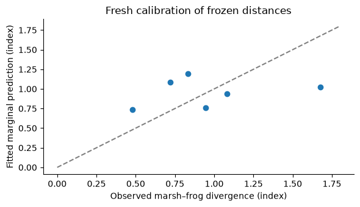

# Experimental multispecies training

[View `multispecies.ipynb` on GitHub](https://github.com/vboussange/ilg-toolkit/blob/main/examples/multispecies.ipynb)

Can species with different regional coverage share landscape features while retaining their
own distance relationships? This notebook trains one neural network for two synthetic species
under complete pooling. Each species has its own embedding parameters, and maximum-likelihood population effects (MLPE) genetic calibration remains
separate for every observed region–species group.

> **Note:** Multispecies support is experimental. The examples use population dissimilarities; species
> labels do not turn the population MLPE model into a model for individual relatedness. Start
> with the [quickstart](quickstart.md) and [MLPE workflow](mlpe_workflow.md) before extending an
> analysis to several species.


```python
from itertools import combinations
from pathlib import Path
from tempfile import TemporaryDirectory

import coordax as cx
import jax
import matplotlib.pyplot as plt
import numpy as np
from ilg_toolkit import (
    calibrate,
    load_model,
    MLPELoss,
    PairwiseObservations,
    RegionBatch,
    save_model,
    TargetSpec,
    train,
    TrainingConfig,
)
from ilg_toolkit.models import UNetEmbeddingDistance
from IPython.display import display, Markdown


jax.config.update("jax_enable_x64", True)
species_order = ("newt", "frog")
target = TargetSpec("synthetic genetic dissimilarity", units="index")
plt.rcParams.update({"axes.spines.top": False, "axes.spines.right": False})
```

## Label species and preserve irregular coverage

Both species are observed in the valley, while only newts are observed in the upland. The
same four location IDs can be reused by different species: identity is scoped by species.
Each `PairwiseObservations` object describes one species, and each sampling-unit entry in
the region carries the matching label.

The full species order is a modeling contract: index 0 means newt and index 1 means frog.
The bare neural distance model records a species count, so retain its original order whenever
transferring or saving the complete landscape genetics model.


```python
def make_region(name, present, seed):
    rng = np.random.default_rng(seed)
    ids = tuple(f"{name}-{corner}" for corner in ("sw", "se", "nw", "ne"))
    features = rng.uniform(0.8, 1.6, (3, 3, 2)).astype(np.float32)
    region = RegionBatch(
        name,
        cx.field(features, "row", "column", "feature"),
        ids * len(present),
        np.tile([[0, 0], [0, 2], [2, 0], [2, 2]], (len(present), 1)),
        feature_names=("canopy", "moisture"),
        species=tuple(label for label in present for _ in ids),
    )
    observations = tuple(
        PairwiseObservations.from_pairs(
            tuple(combinations(ids, 2)),
            np.array([0.4, 0.7, 1.4, 0.6, 0.9, 0.8]) * (1 + 0.2 * species_order.index(label))
            + rng.normal(0, 0.01, 6),
            target=target,
            species=label,
        )
        for label in present
    )
    return region, observations


coverage = (species_order, ("newt",))
prepared = [make_region("valley", coverage[0], 14), make_region("upland", coverage[1], 15)]
regions = tuple(item[0] for item in prepared)
observations = tuple(item[1] for item in prepared)

fig, axes = plt.subplots(1, 2, figsize=(8, 3))
for ax, region in zip(axes, regions, strict=True):
    image = ax.imshow(region.feature_array[..., 0], cmap="viridis")
    ax.set(title=f"{region.name}: canopy", xlabel="column", ylabel="row")
    fig.colorbar(image, ax=ax)
fig.tight_layout()
plt.show()
display(
    Markdown(
        "| Region | Newt pairs | Frog pairs |\n| --- | ---: | ---: |\n"
        "| Valley | 6 | 6 |\n| Upland | 6 | 0 |"
    )
)
```


    

    


| Region | Newt pairs | Frog pairs |
| --- | ---: | ---: |
| Valley | 6 | 6 |
| Upland | 6 | 0 |


## Train shared patch features and species-specific distances

`UNetEmbeddingDistance` maps patch features to species-specific embeddings; squared
embedding distances are ecological distances. Here a small U-Net keeps execution
practical on a CPU. This is a different distance family from effective resistance through
a conductance grid graph; see the [model API](../api/models.md) for both definitions.

Species receive equal total influence, and regions receive equal influence within a species.
Thus valley-newt and upland-newt each receive one quarter of the total weight, and valley-frog
receives one half. Region-first sampling and species microbatches control execution without
changing these intended weights. MLPE still evaluates each selected group's complete set of
pairs, retaining population dependence.


```python
def model_template(seed):
    return UNetEmbeddingDistance(
        2,
        num_species=2,
        patch_size=1,
        patch_microbatch_size=4,
        base_channels=2,
        embedding_dim=2,
        dropout=0,
        key=jax.random.key(seed),
    )


loss = MLPELoss()
state = train(
    regions,
    observations,
    distance_model=model_template(8),
    species=species_order,
    config=TrainingConfig(
        loss=loss,
        steps=3,
        eval_every=3,
        region_batch_size=1,
        species_batch_size=1,
        species_microbatch_size=1,
        seed=8,
    ),
)
model = state.selected_model
print("Retained species order:", model.species)
print("Training criterion by species:", state.history[-1].training_by_species)

rows = [
    "| Region | Species | Signed slope | Population variance | Residual variance |",
    "| --- | --- | ---: | ---: | ---: |",
]
for region, present in zip(regions, coverage, strict=True):
    for name in present:
        fitted = model.calibration.for_region(region.name, species_order.index(name))
        rows.append(
            f"| {region.name} | {name} | {fitted.slope:.3f} | "
            f"{fitted.unit_variance:.4f} | {fitted.residual_variance:.4f} |"
        )
display(Markdown("\n".join(rows)))
```

    Retained species order: ('newt', 'frog')
    Training criterion by species: {'newt': 0.27509472449531724, 'frog': 0.15351942354090323}


| Region | Species | Signed slope | Population variance | Residual variance |
| --- | --- | ---: | ---: | ---: |
| valley | newt | 0.081 | 0.0309 | 0.0618 |
| valley | frog | 0.368 | 0.0423 | 0.0847 |
| upland | newt | -0.147 | 0.0289 | 0.0579 |


> **Note:** The calibration parameters above belong to a fixed-budget joint training run. Three updates
> are not a claim of variance convergence. Patch features and species parameters are estimated
> under complete pooling, while coefficients, variances, and population effects stay group-specific
> for each region–species group. Inspecting these training fits does not measure generalization.

## Query one or several species

A string selects one species and returns a `Prediction`; a sequence returns a mapping. The
request order can differ from the original parameter order without reassigning parameters.
Queries use each species' located sampling units and preserve the requested pair order.

> **Note:** The distance-model calls below also require the retained species order because the bare model
> has no species names. Genetic predictions additionally use the fitted group calibration.


```python
valley = regions[0]
ids = valley.sampling_unit_ids[:4]
query_pairs = [(ids[3], ids[0]), (ids[1], ids[2])]
query_species = ("frog", "newt")
genetic = model.predict(valley, species=query_species, pairs=query_pairs)
ecological = model.distance_model.predict(
    valley, species=query_species, species_order=model.species, pairs=query_pairs
)
rows = [
    "| Species | Requested pair | Ecological distance | Genetic prediction (index) |",
    "| --- | --- | ---: | ---: |",
]
for name in query_species:
    for pair, distance, predicted in zip(
        genetic[name].pairs, ecological[name].values, genetic[name].values, strict=True
    ):
        rows.append(
            f"| {name} | {' – '.join(pair)} | {float(distance):.4f} | {float(predicted):.3f} |"
        )
display(Markdown("\n".join(rows)))
print("One-species result:", model.predict(valley, species="frog", pairs=query_pairs).pairs)
```


| Species | Requested pair | Ecological distance | Genetic prediction (index) |
| --- | --- | ---: | ---: |
| frog | valley-ne – valley-sw | 0.3932 | 1.345 |
| frog | valley-se – valley-nw | 0.0738 | 0.691 |
| newt | valley-ne – valley-sw | 0.1565 | 0.770 |
| newt | valley-se – valley-nw | 0.2978 | 0.864 |


    One-species result: (('valley-ne', 'valley-sw'), ('valley-se', 'valley-nw'))


## Transfer only frogs without reordering parameters

> **Note:** We now create a separate marsh with frog observations. Its measurements were not used for
> distance-model training or selection. `calibrate` freezes the complete distance model,
> including both species' parameter sets, and estimates a fresh relationship only for the
> supplied marsh–frog group.

> **Note:** Pass `species=model.species`, the original full order. Inferring an order from the frog-only
> observations would incorrectly associate the frog with the newt's parameter index. Fresh
> calibration is needed for the new region; support conditioning cannot establish it.


```python
marsh, marsh_observations = make_region("marsh", ("frog",), 31)
adapted = calibrate(
    marsh,
    marsh_observations[0],
    model.distance_model,
    species=model.species,
    loss=loss,
    max_iterations=2000,
)
marsh_fit = adapted.calibration.for_region("marsh", species_order.index("frog"))
marsh_prediction = adapted.predict(
    marsh, species="frog", pairs=marsh_observations[0].observed_pairs
)
print("Retained full species order:", adapted.species)
print(
    f"Marsh–frog slope={marsh_fit.slope:.3f}, population variance={marsh_fit.unit_variance:.5f}, "
    f"residual variance={marsh_fit.residual_variance:.5f}, converged={marsh_fit.converged}"
)
print(
    f"Calibration uses {len(marsh_fit.population_ids)} populations and "
    f"{len(marsh_fit.calibration_pairs)} pairs."
)
fig, ax = plt.subplots(figsize=(6, 3.5))
ax.scatter(marsh_observations[0].observed_values, marsh_prediction.values)
ax.plot([0, 1.8], [0, 1.8], linestyle="--", color="gray")
ax.set(
    xlabel="Observed marsh–frog divergence (index)",
    ylabel="Fitted marginal prediction (index)",
    title="Fresh calibration of frozen distances",
)
fig.tight_layout()
plt.show()
```

    Retained full species order: ('newt', 'frog')
    Marsh–frog slope=0.183, population variance=0.07079, residual variance=0.03684, converged=True
    Calibration uses 4 populations and 6 pairs.


    

    


> **Note:** This plot assesses a relationship fitted to the marsh observations themselves. It is not a
> population-holdout evaluation of predictive transfer. The returned model has only marsh–frog calibration;
> it does not merge the valley or upland relationships into the result. To assess explanatory
> transfer, compare it with the matching geographic MLPE baseline and repeat population splits,
> following the [MLPE workflow](mlpe_workflow.md).

## Save target and species semantics together

A saved landscape genetics model retains the full species order even if calibration covers one species.
The template still needs two species and the same architecture and static settings. Neural
weights may use float32 while MLPE uses float64; enable float64 before loading to preserve
the statistical state. Keep feature meanings and order consistent at prediction time.


```python
with TemporaryDirectory() as directory:
    path = Path(directory) / "marsh-frog.eqx"
    save_model(path, adapted)
    restored = load_model(path, distance_model=model_template(0))
    print("Reloaded species order:", restored.species)
    print("Reloaded target:", restored.target)
    print(
        "Reloaded frog predictions:",
        np.asarray(restored.predict(marsh, species="frog", pairs=marsh_prediction.pairs).values),
    )
```

    Reloaded species order: ('newt', 'frog')
    Reloaded target: TargetSpec(name='synthetic genetic dissimilarity', units='index', kind='dissimilarity', transform='identity')
    Reloaded frog predictions: [0.75635694 0.93949019 1.02317104 1.08516458 1.19399237 0.73511307]


## Limits and study choices

> **Note:** Complete pooling can share useful landscape structure but may also impose an unsuitable relationship
> on a species with limited coverage. Equal species influence is a modeling policy, not a
> substitute for sufficient observations or a check of biological compatibility. Genetic
> calibration here is group-specific; the toolkit does not apply hierarchical shrinkage between groups.

In a real analysis, retain population splits, species coverage, feature preprocessing,
candidate-selection records, and numerical settings with the study. Assess each represented
group and report signed slopes and variance diagnostics; an average across species can conceal
a weak or reversed relationship for one of them.
