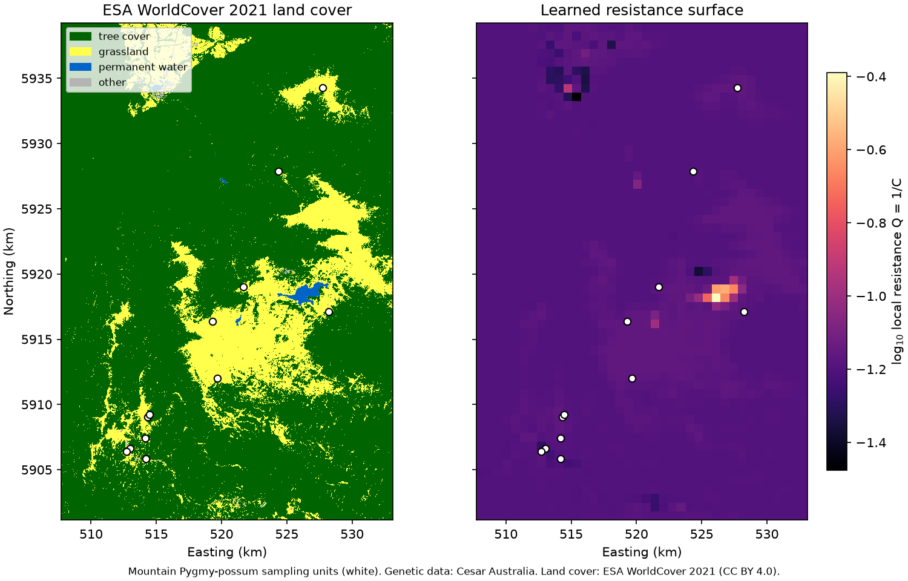

# Quickstart

[View `quickstart.py` on GitHub](https://github.com/vboussange/ilg-toolkit/blob/main/examples/quickstart.py)

```python
"""A Mountain Pygmy-possum resistance surface trained on land cover and genetic data.

Pairwise Fst between 12 Mountain Pygmy-possum (Burramys parvus) sampling units in
the Victorian Alps, kindly provided by Cesar Australia, is related to ESA WorldCover
2021 land cover (CC BY 4.0). A log-linear patch encoder maps land-cover fractions to
the vertex conductances of a conductance grid graph, whose effective resistances
predict the odds of Fst. Install the ``examples`` extra and run this script: it
downloads 0.25 MB of example data on first use and writes ``quickstart.png``.
"""

import urllib.request
import zipfile
from pathlib import Path

import coordax as cx
import jax
import matplotlib.pyplot as plt
import numpy as np
import optax
import pandas as pd
import rioxarray
import xarray as xr
from ilg_toolkit import (
    Log1pLoss,
    PairwiseObservations,
    RegionBatch,
    TargetSpec,
    train,
    TrainingConfig,
)
from ilg_toolkit.models import initialize_uniform_conductance, LogLinearConductance
from matplotlib.colors import ListedColormap
from matplotlib.patches import Patch


# Effective resistance needs float64: enable x64 before creating any inputs.
jax.config.update("jax_enable_x64", True)

DATA_URL = (
    "https://github.com/vboussange/ilg-toolkit/releases/download/"
    "example-data-v1/mountain-pygmy-possum.zip"
)
CACHE = Path(__file__).resolve().parent / "data" / "example-data-v1"
COARSENING = 10  # Averages 8.36 m land-cover pixels into cells of about 84 m.
PATCH_SIZE = 8  # Groups 8x8 cells into one vertex of about 669 m.
# ESA WorldCover classes merged into landscape features; tree cover is the reference.
FEATURE_CLASSES = {
    "grassland": [30],
    "permanent water": [80],
    "other": [20, 40, 50, 60, 90],  # Shrubland, cropland, built-up, bare, herbaceous wetland.
}

# Download the example data once and cache it next to this script.
data = CACHE / "mountain-pygmy-possum"
if not data.is_dir():
    CACHE.mkdir(parents=True, exist_ok=True)
    archive, _ = urllib.request.urlretrieve(DATA_URL, CACHE / "mountain-pygmy-possum.zip")
    with zipfile.ZipFile(archive) as contents:
        contents.extractall(CACHE)
    Path(archive).unlink()
landcover = rioxarray.open_rasterio(data / "landcover.tif").squeeze("band", drop=True).load()
sites = pd.read_csv(data / "sites.csv", index_col="site")
fst = pd.read_csv(data / "fst.csv", index_col="site")

# Land-cover fractions per coarse cell, trimmed to whole patches.
fractions = (
    xr.concat(
        [landcover.isin(codes) for codes in FEATURE_CLASSES.values()],
        dim=pd.Index(list(FEATURE_CLASSES), name="feature"),
    )
    .astype(np.float32)
    .coarsen(y=COARSENING, x=COARSENING, boundary="trim")
    .mean()
)
fractions = fractions.isel(
    y=slice(fractions.sizes["y"] // PATCH_SIZE * PATCH_SIZE),
    x=slice(fractions.sizes["x"] // PATCH_SIZE * PATCH_SIZE),
)
features = fractions.rename(y="row", x="column").transpose("row", "column", "feature")
# Each sampling unit sits at its nearest coarse cell.
grid_positions = np.stack(
    [
        fractions.indexes["y"].get_indexer(sites["y"], method="nearest"),
        fractions.indexes["x"].get_indexer(sites["x"], method="nearest"),
    ],
    axis=1,
)

region = RegionBatch(
    name="victorian-alps",
    features=cx.from_xarray(features),
    sampling_unit_ids=tuple(sites.index),
    grid_positions=grid_positions,
)
observations = PairwiseObservations(
    tuple(fst.index),
    fst.to_numpy(),
    target=TargetSpec("pairwise Fst", units="proportion", transform="odds"),
)
loss = Log1pLoss()
distance_model = initialize_uniform_conductance(
    LogLinearConductance(in_channels=3, patch_size=PATCH_SIZE), region, observations, loss
)
state = train(
    region,
    observations,
    distance_model=distance_model,
    config=TrainingConfig(loss=loss, steps=100, optimizer=optax.adam(0.1)),
)
conductance = state.selected_model.distance_model.conductance_surface(region)
resistance = 1 / conductance  # Local resistance Q = 1/C of each vertex.

rows, columns = conductance.shape
print(f"Conductance grid graph: {rows}x{columns} vertices")
print(f"Best uniform conductance: {float(distance_model.conductance_surface(region)[0, 0]):.4g}")
print(
    f"Log1p loss: {state.history[0].training_loss:.5f} at step 0, "
    f"{state.selected_loss:.5f} at step {state.selected_step}"
)
print("Log-linear coefficients relative to tree cover:")
for name, value in zip(
    FEATURE_CLASSES, state.selected_model.distance_model.coefficients[0].tolist(), strict=True
):
    print(f"  {name}: {value:+.3f}")
prediction = state.selected_model.predict(region, pairs=observations.observed_pairs)
for pair, predicted, observed in list(
    zip(prediction.pairs, prediction.values, observations.observed_values, strict=True)
)[:3]:
    print(f"Fst {pair[0]} - {pair[1]}: predicted {predicted:.3f}, observed {observed:.3f}")

# Land cover and sampling units next to the trained resistance surface, in km.
cell = COARSENING * abs(landcover.rio.resolution()[0])
x, y = fractions["x"].to_numpy(), fractions["y"].to_numpy()
extent = np.array([x[0] - cell / 2, x[-1] + cell / 2, y[-1] - cell / 2, y[0] + cell / 2]) / 1e3
classes = np.zeros(landcover.shape, dtype=np.uint8)
for index, codes in enumerate(FEATURE_CLASSES.values(), start=1):
    classes[landcover.isin(codes).to_numpy()] = index
colors = ["#006400", "#ffff4c", "#0064c8", "#b4b4b4"]
figure, (cover, surface) = plt.subplots(
    1, 2, figsize=(10, 6.4), sharex=True, sharey=True, layout="constrained"
)
cover.imshow(
    classes,
    cmap=ListedColormap(colors),
    vmin=-0.5,
    vmax=3.5,
    extent=np.array(landcover.rio.bounds())[[0, 2, 1, 3]] / 1e3,
    interpolation="nearest",
)
cover.legend(
    handles=[
        Patch(color=color, label=label)
        for color, label in zip(colors, ["tree cover", *FEATURE_CLASSES], strict=True)
    ],
    loc="upper left",
    fontsize=8,
)
cover.set(title="ESA WorldCover 2021 land cover", xlabel="Easting (km)", ylabel="Northing (km)")
image = surface.imshow(np.log10(np.asarray(resistance)), cmap="magma", extent=extent)
figure.colorbar(image, ax=surface, shrink=0.8, label="log$_{10}$ local resistance Q = 1/C")
surface.set(title="Trained resistance surface", xlabel="Easting (km)")
for axis in (cover, surface):
    axis.scatter(sites["x"] / 1e3, sites["y"] / 1e3, s=30, c="white", edgecolors="black")
    axis.set_xlim(extent[:2])
    axis.set_ylim(extent[2:])
figure.supxlabel(
    "Mountain Pygmy-possum sampling units (white). Genetic data: Cesar Australia. "
    "Land cover: ESA WorldCover 2021 (CC BY 4.0).",
    fontsize=8,
)
figure.savefig("quickstart.png", dpi=150)
print("Saved quickstart.png")
```

## Output

```text
Conductance grid graph: 57x38 vertices
Best uniform conductance: 15.31
Log1p loss: 0.00240 at step 0, 0.00223 at step 100
Log-linear coefficients relative to tree cover:
  grassland: -0.094
  permanent water: -7.633
  other: +8.035
Fst Basalt Hill - Bundara Scree: predicted 0.093, observed 0.176
Fst Basalt Hill - Higginbotham East: predicted 0.106, observed 0.186
Fst Basalt Hill - Higginbotham West: predicted 0.110, observed 0.187
Saved quickstart.png
```


